# streamlitd

**Streamlit for D.** Write data apps as a plain D function that reruns from top to bottom on every
interaction, the way you write them in Python with [Streamlit](https://streamlit.io).
`dub build` produces **one self-contained binary**: the web UI, charts, maps, math rendering and
fonts are compiled in, so it runs offline and deploys by copying a file.

```d
import streamlitd;

void app(St st)
{
    st.title("Hello 👋");
    auto name = st.textInput("Your name", "World");
    auto n = st.slider("Times", 1, 10, 3);
    if (st.button("Greet", type: "primary"))
        st.success("Hello " ~ name ~ "!");
}

mixin StreamlitMain!app;
```

```sh
dub run --compiler=ldc2          # → http://localhost:8501
```

📚 **Documentation:** [docs/](docs/README.md) has the [getting started](docs/getting-started.md) guide, the
[tutorial](docs/tutorial.md) and the [Python → D cheat sheet](docs/cheatsheet.md).

## Screenshots

| | |
|---|---|
| 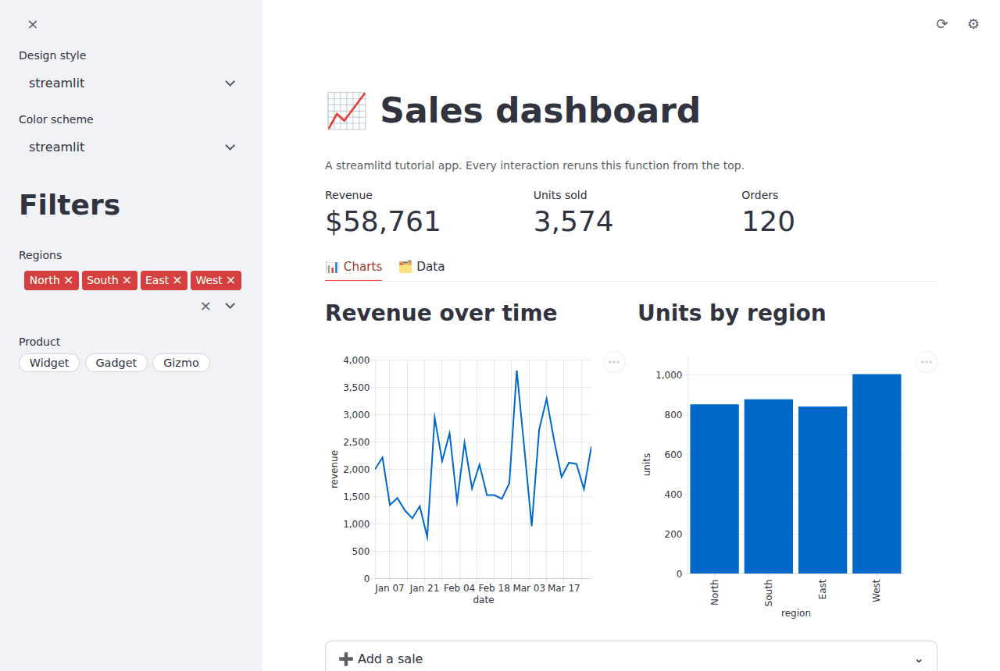 **Sales dashboard** from the [tutorial](docs/tutorial.md): cached CSV, filters, metrics, charts | 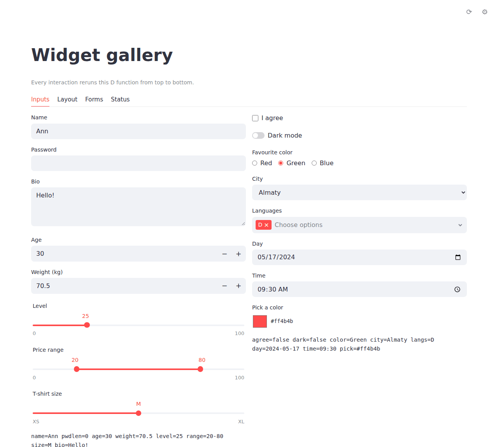 **Every input widget**: text, numbers, sliders, selects, dates, colors |
| 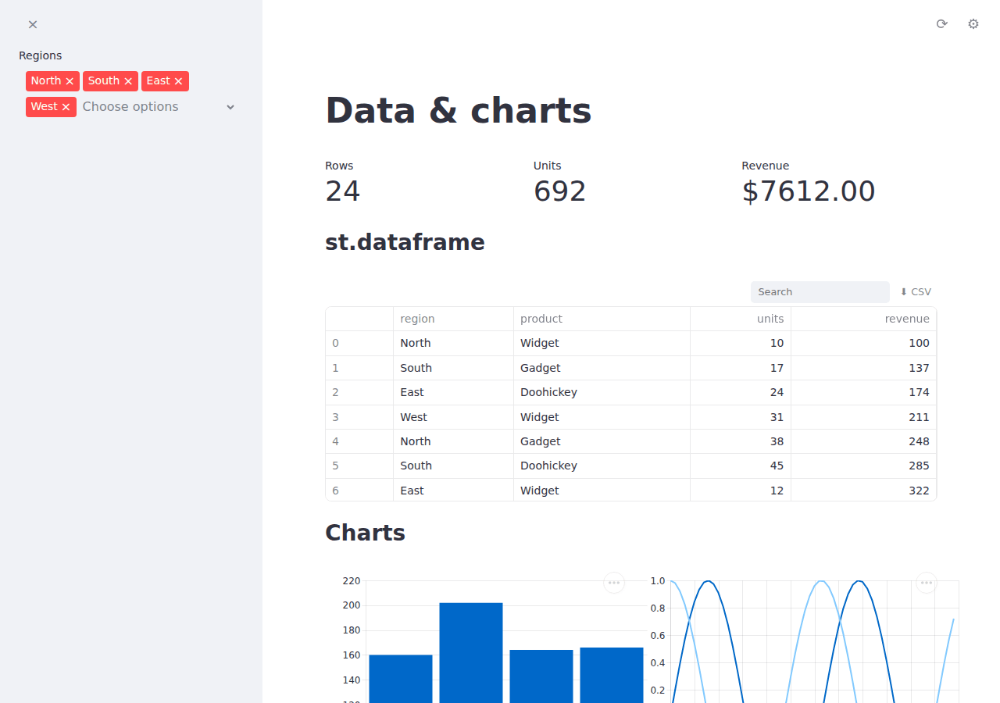 **DataFrames**: sortable, searchable tables with CSV export | 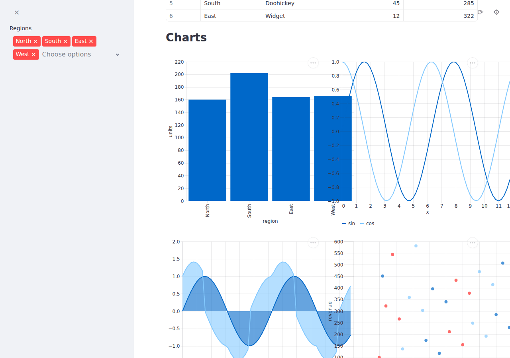 **Charts**: line, bar, area, scatter and any Vega-Lite spec |
| 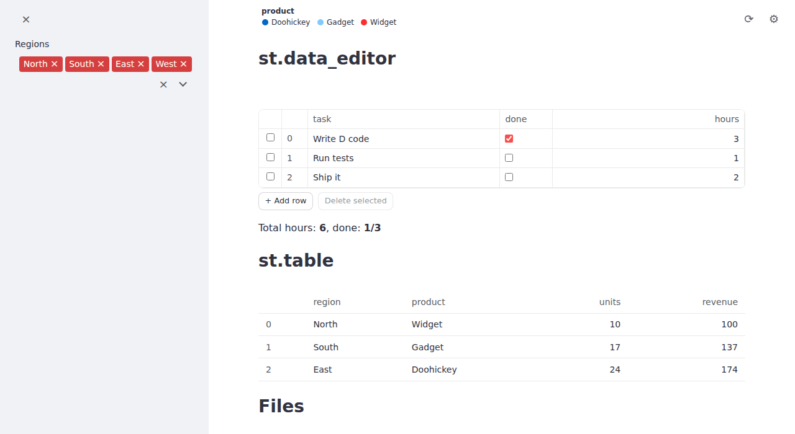 **Data editor**: edit, add and delete rows | 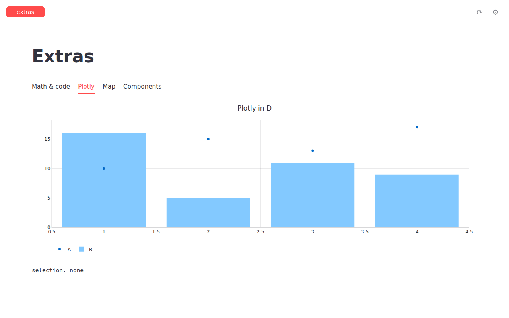 **Plotly** figures with selection events |
| 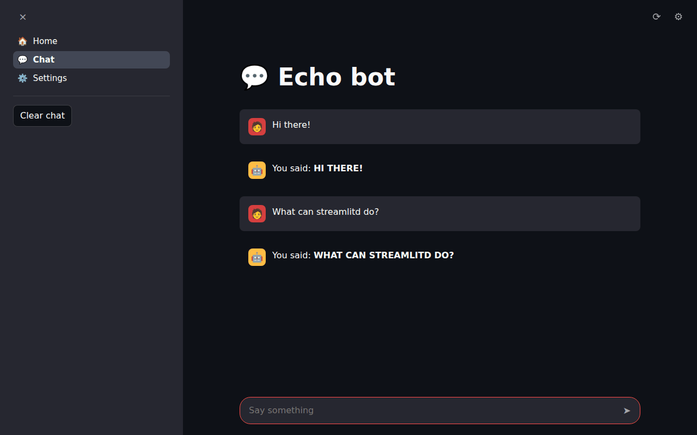 **Chat UI** and **multipage** navigation (dark mode) | 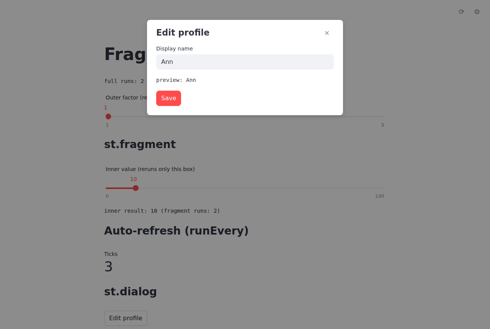 **Dialogs, fragments** and partial reruns |
| 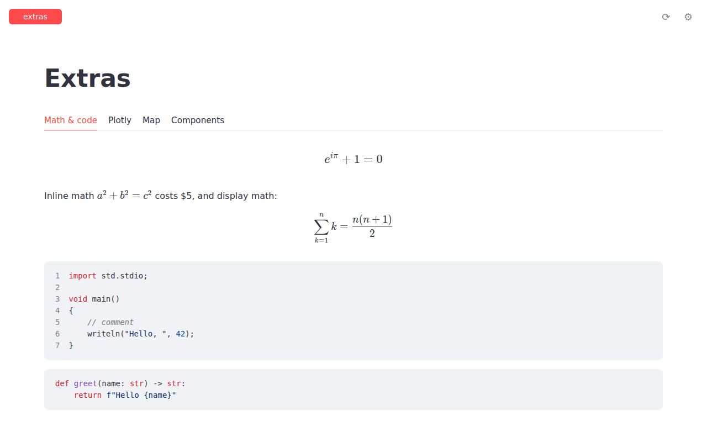 **LaTeX** (KaTeX) and syntax-highlighted code | 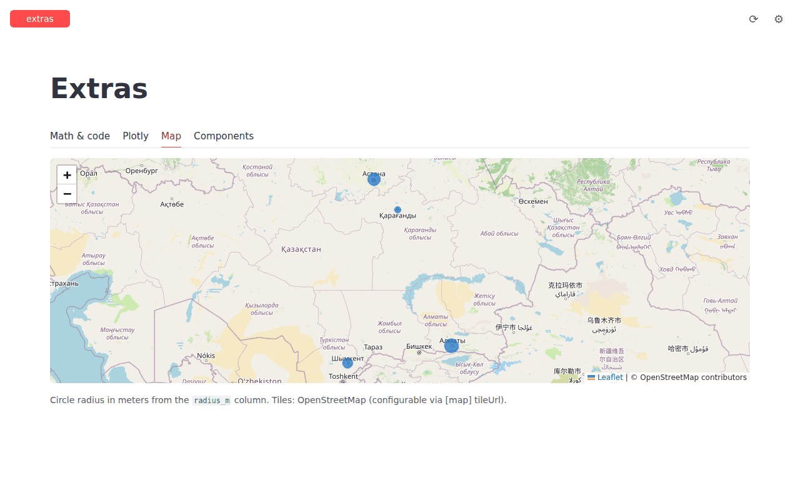 **Maps** (Leaflet, configurable tiles) |
| 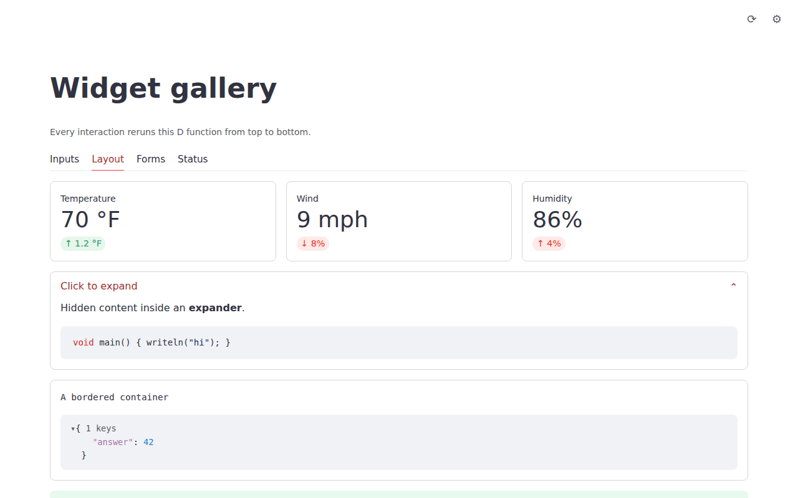 **Layout**: columns, tabs, expanders, containers, popovers | 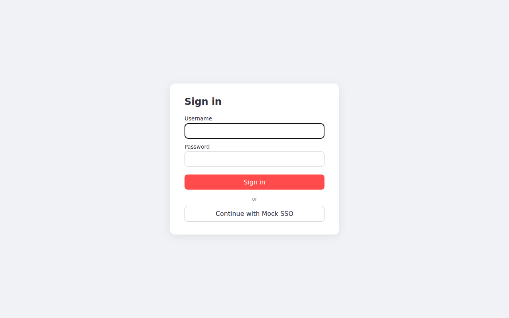 **Login**: password users and OIDC single sign-on |
| 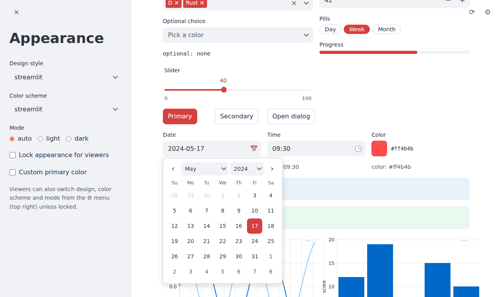 **Themed controls**: searchable selects, calendar, time list and color picker (no native browser pop-ups) | 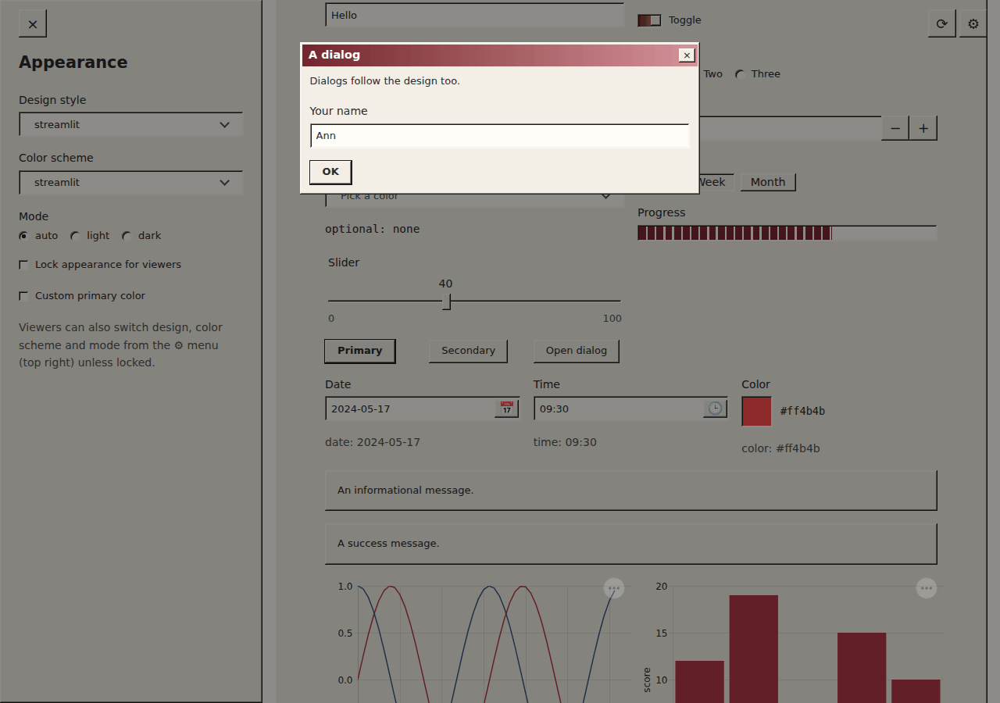 Design × scheme: `win95` × `paper` |

**8 design styles × 8 color schemes × light/dark** ([theming](docs/theming.md)): streamlit, terminal, retro,
win95, XP, brutalist, material and glass, each usable with any color scheme:

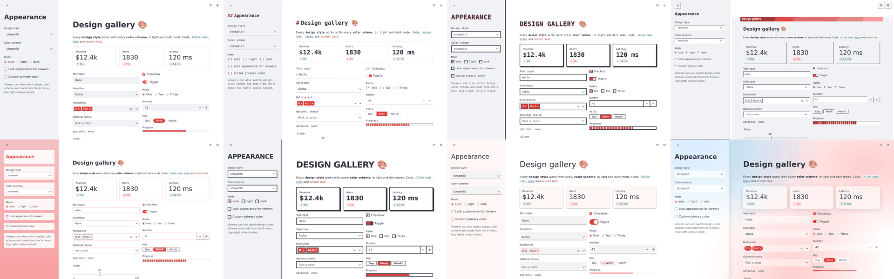

| | |
|---|---|
| 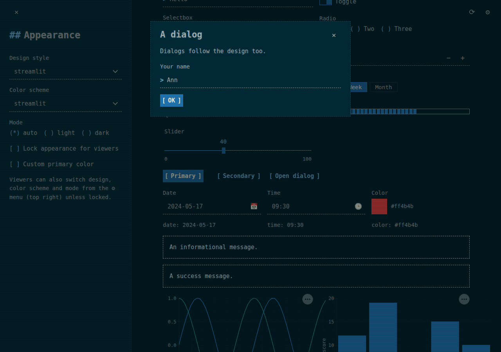 `terminal` × `solarized`, dark |  `win95` × `paper` |

## Features

- **Streamlit's programming model:** reruns, widget state, `st.session`, callbacks, forms,
  `st.rerun`/`st.stop`, `cacheData`/`cacheResource`, multipage `st.navigation`, query params.
- **About 70 elements and widgets:**
  - text, markdown (with `:color[...]` and `$math$`), alerts, metrics, JSON, progress, spinner, toast
  - all input widgets, file upload and download, chat input and messages
  - pills, segmented control, feedback
- **Layout:** sidebar, columns, tabs, expanders, containers, popovers, `st.empty`, dialogs,
  status containers, **fragments** with `runEvery` auto-refresh.
- **Data:** a `DataFrame` type (structs, CSV, JSON; filter, sort, groupBy), interactive tables, a
  data editor, Vega-Lite charts, Plotly, maps, images, audio, video.
- **Theming:** 8 design styles (terminal, retro, win95, XP, brutalist, material, glass, streamlit) ×
  8 color schemes × light/dark, custom colors and fonts (Streamlit-compatible `[theme]` keys), and a
  viewer appearance menu.
- **Production:**
  - worker threads, so CPU-heavy sessions don't block other users
  - `config.toml` and `secrets.toml` (existing `.streamlit/` files work)
  - base URL path for reverse proxies, origin checks, session limits
  - Docker image, health endpoint
- **Auth:** password users (PBKDF2) and OIDC (Google, Entra ID, Keycloak, …), `st.user`.
- **Custom components** compatible with Streamlit's component protocol.
- **JSON API endpoints** next to the UI (FastAPI-style typed REST interfaces via vibe.d), on the same
  port and login, with an optional generated **OpenAPI** document and **Swagger UI** at `/docs`:
  [API endpoints](docs/api-endpoints.md).
- **Testing:** headless `AppTest` for unit tests; Playwright end-to-end tests.
- **Branding:** streamlitd's own favicon by default; set yours per app (`[server] favicon`, `--favicon`) or
  per page (`st.setPageConfig(icon:)` with an emoji, URL or image file; multipage apps show the page icon).

## Documentation

| | |
|---|---|
| [Getting started](docs/getting-started.md) | install, first app, project layout |
| [Tutorial](docs/tutorial.md) | build a dashboard step by step |
| [Core concepts](docs/concepts.md) | reruns, state, callbacks, forms, fragments, caching, threads |
| [Layout & navigation](docs/layout-and-navigation.md) · [Data & charts](docs/data-and-charts.md) · [Theming](docs/theming.md) | guides |
| [Configuration](docs/configuration.md) · [Deployment](docs/deployment.md) (Docker, nginx, systemd) · [Authentication](docs/authentication.md) | running in production |
| [Custom components](docs/custom-components.md) · [JSON API endpoints](docs/api-endpoints.md) · [Testing](docs/testing.md) | extending and testing |
| [Porting from Python](docs/porting-from-python.md) · [Cheat sheet](docs/cheatsheet.md) · [API reference](docs/api-reference.md) | reference |
| [Troubleshooting](docs/troubleshooting.md) · [Architecture](docs/architecture.md) | FAQ and internals |

## Requirements

- LDC ≥ 1.36 and dub. **Always build with `--compiler=ldc2`**, because dub may otherwise pick gdc.
- OpenSSL 3 and zlib at runtime, as with every vibe.d app.

## Repository layout

```
source/streamlitd/   the library (server, session, St API, DataFrame, charts, auth, ...)
assets/              frontend: index.html, app.js, style.css, vendor/ (bundled JS libraries)
examples/            runnable apps: hello, widgets, data, multipage, themes, prod, fragments, extras, auth, tutorial, api
docs/                documentation and screenshots
tests/unit/          headless AppTest suites (dub test)
tests/e2e/           Playwright end-to-end tests and the screenshot script
tools/               asset list, API docs and doc-snippet generators/checkers
```

## Tests

```sh
./run-tests.sh      # D unit tests + Playwright e2e tests + compile every doc snippet
```

## License

MIT. Bundled third-party libraries are listed in [assets/vendor/licenses](assets/vendor/licenses/README.md).
