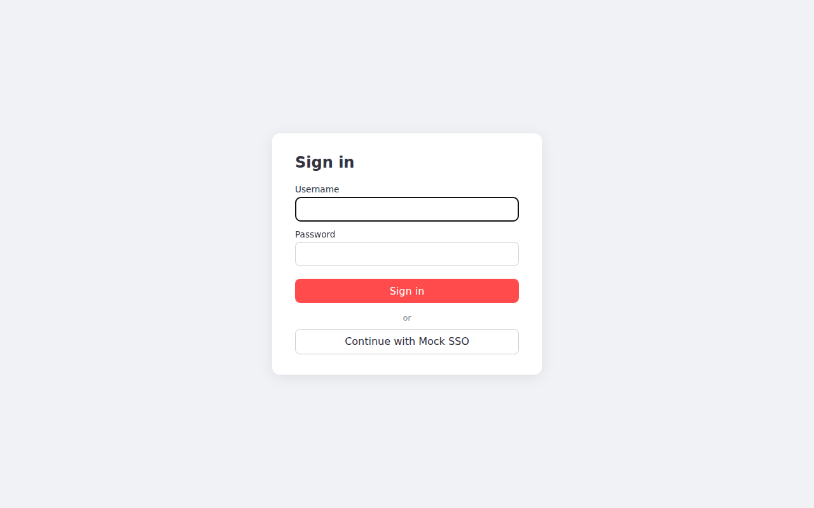

# Authentication

streamlitd has three ways to log in, configured in the `[auth]` section of
`.streamlitd/config.toml` (or `secrets.toml`, like Streamlit 1.42+):

- **Accounts with sign-up:** people create an account on the login page. Passwords are hashed
  automatically, and the first account becomes the administrator. Users live in a user store,
  the file `.streamlitd/users.json` by default.
- **Users in secrets.toml:** a fixed list of users with password hashes you make yourself
  (`--hash-password`). They are read-only.
- **OpenID Connect (OIDC) single sign-on:** Google, Microsoft Entra ID, Keycloak, Okta, Auth0, …

They can be combined. All of them give the app `st.user`, roles and the same login cookie.



## Quick setup: sign-up

1. Turn on authentication in `.streamlitd/config.toml`:

   ```toml
   [auth]
   required = true     # the whole app is behind the login page
   ```

   That is all. With an `[auth]` section that lists no users or providers, sign-up is on until
   the first account exists (`registration = "first_admin"`). A cookie secret is generated into
   `.streamlitd/auth_secret` on the first start (unless you set `cookie_secret`).

2. Start the app and open it. You land on the login page: choose **Create one**, then pick a
   username and password. This first account gets the `admin` role.

3. Use the user, roles and the admin panel in the app:

<!-- compile -->
```d
import streamlitd;

void home(St st)
{
    st.title("Hello " ~ st.user.name);
    st.write("Roles:", st.user.roles.join(", "));
}

void admin(St st)
{
    st.title("Users");
    st.userAdmin(); // add users, roles, invites, reset links, disable, delete
}

void app(St st)
{
    Page[] pages = [Page(&home, "Home", "🏠")];
    if (st.user.isAdmin)
        pages ~= Page(&admin, "Admin", "🛡️");
    auto page = st.navigation(pages, position: "top");
    st.userMenu(); // picture or initials, "Account settings", "Log out"
    page.run(st);
}

mixin StreamlitMain!app;
```

`examples/accounts` is this app with invites, a page for one role and an admin-only API endpoint.

## Accounts: sign-up and roles

### Who can sign up

`[auth] registration` decides:

| Value | Who can create an account |
|---|---|
| `first_admin` | only while there is no admin; that account becomes admin. Afterwards admins add users (admin panel or `--add-user`). With [`admins`](#roles) set, only those users can sign up |
| `open` | anyone; the first account is admin |
| `approval` | anyone, but new accounts wait until an admin approves them (the first account is admin and needs no approval) |
| `invite` | only with a one-time invite link from an admin (the first account needs none and becomes admin) |
| `off` | nobody; admins and the command line create users |

The default is `first_admin` when `[auth]` lists no users and no OIDC providers, and `off`
otherwise, so existing setups keep working unchanged.

The sign-up form asks for a username (3–64 characters: letters, digits, `.`, `_`, `-`; not case
sensitive), a password twice, and the fields in `signup_fields` (default: full name and email,
both optional unless `require_email = true`).

### The pages

| Page | What it does |
|---|---|
| `<base>/auth/login` | username and password, SSO buttons, a **Create one** link while sign-up is possible; after login the browser returns to the page it came from (`?next=`) |
| `<base>/auth/register` | the sign-up form (`?invite=<code>` fills in the invite) |
| `<base>/auth/account` | name and email, password change, **Log out everywhere**. Users from secrets.toml or SSO see their details read-only |
| `<base>/auth/reset?token=…` | sets a new password from a reset link made by an admin |
| `<base>/auth/logout` | logs out |

`st.userMenu()` links to the account page (**Account settings**) for accounts in the user store.
The pages use the primary color of the app's color scheme and follow the OS light/dark mode.

### Roles

Roles are plain names: `admin` is the one streamlitd itself uses (the admin panel); the others
mean whatever your app decides (`editor`, `viewer`, `finance`, …).

<!-- wrap -->
```d
if (st.user.hasRole("editor"))
    st.button("Edit");
st.requireRole("finance");      // everybody else: an error, and the run stops here
st.write("Quarterly numbers");
```

| Code | Meaning |
|---|---|
| `st.user.roles` | the roles, read on every run, so changes apply at once |
| `st.user.isAdmin`, `st.user.hasRole("x")` | role checks |
| `st.requireLogin()` | send anonymous visitors to the login page |
| `st.requireRole("x")` | login page for anonymous visitors, an error and stop for users without the role |
| `requireRole(req, res, "x")` | in [API routes](api-endpoints.md#login-and-access-control): 401 without login, 403 without the role |

Where roles come from:
- accounts in the user store: set in the admin panel, with `--roles`, by `default_roles` for new
  accounts, or from the invite they signed up with;
- users in secrets.toml: `roles = ["admin"]` in `[auth.users.<name>]`;
- `admins = ["alice", "boss@example.com"]` in `[auth]`: these usernames or emails are always admins.
  This also works for SSO users before they first sign in.

With `admins` set, nobody becomes admin automatically:
- the first account is an ordinary one;
- the listed users need no invite or approval;
- in `first_admin` mode only they can sign up.

### The admin panel

`st.userAdmin()` is a ready-made panel for admins (other users see an error). Put it on a page
only admins can open, as in the quick setup. It has three tabs:

- **Users:** every account with name, email, roles, status (active, pending, disabled), sign-in
  method, creation time and last login. Choose a user to:
  - change their roles;
  - approve a pending account;
  - disable or enable it (disabling ends their logins at once);
  - make a **password reset link**;
  - **log out everywhere**;
  - delete them.

  Admins cannot disable or delete themselves, and the last admin cannot lose the role.
- **Add user:** username, name, email, password and roles. The password is hashed before it is
  stored.
- **Invites:** create a one-time sign-up link with roles and a validity period (1–90 days), and
  list or revoke open invites. The link is shown once, with a copy button.

Reset links and invite links are one-time and expire (24 hours, and the chosen number of days).
streamlitd sends no email, so the admin passes them on.

### Accounts from code

`st.accounts` (in the app) and `accounts()` (in API routes) give the same service; passwords
are always hashed for you:

<!-- wrap -->
```d
auto acc = st.accounts;
if (st.button("Create demo users"))
{
    try
    {
        acc.createUser("ann", "correct horse battery", "Ann Lee", "ann@example.com", ["editor"]);
        st.success("Created ann");
    }
    catch (AccountError e)
        st.error(e.msg);              // e.g. "The username "ann" is taken."
}
foreach (u; acc.users)
    st.write(u.username, u.roles, u.status);
```

| Method | Does |
|---|---|
| `register(username, password, name, email, invite)` | a sign-up with the rules of `registration` |
| `createUser(username, password, name, email, roles)` | a new account (no registration rules) |
| `setPassword`, `setRoles`, `setDisabled`, `approve`, `deleteUser`, `logoutEverywhere` | admin changes |
| `user(username)`, `users()` | read accounts (`StoredUser`: `username`, `name`, `email`, `roles`, `status`, `created`, `lastLogin`, `provider`, `extra`) |
| `createInvite(roles, days)` + `inviteLink(code)`, `invites()`, `revokeInvite(id)` | invites |
| `createResetLink(username, hours)` | a one-time password reset link |

They throw `AccountError` with a message for the user (taken username, weak password, last
admin, …).

### Command line

The app's binary manages the user store too, which helps on servers and in Docker:

```sh
./myapp --add-user ann --roles admin,editor --email ann@example.com --name "Ann Lee"   # asks for the password
echo 'correct horse battery' | ./myapp --add-user bob                                  # or reads it from stdin
./myapp --list-users
./myapp --set-password ann
./myapp --set-roles bob --roles viewer          # --roles= removes all roles
./myapp --reset-link bob                        # prints /auth/reset?token=...; put your address in front
./myapp --delete-user bob
```

They use the same configuration as the server (config files, `STREAMLITD_AUTH_*` variables).

### Where users are stored

By default in `.streamlitd/users.json` (`[auth] users_file`; or the environment variable
`STREAMLITD_AUTH_USERS_FILE`):

- it is written atomically, with mode 0600, and holds only password **hashes**;
- invites are stored as hashes of their codes;
- back it up like any data file;
- a file that cannot be read stops the server; it is never reset silently.

Several server processes must not share one file. For that, or to keep users in your database,
implement `UserStore` and register it before the server starts:

<!-- compile -->
```d
import streamlitd;

/// Users in memory: they are lost on restart (an example; put a database behind the same interface).
class MyStore : MemoryUserStore
{
    protected override void changed()
    {
        // called after every change: write `users` and `invites` to your database here
    }
}

shared static this() { useUserStore(new MyStore); } // before the server starts

void app(St st) { st.write("Hello", st.user.name); }

mixin StreamlitMain!app;
```

A `UserStore` has `find`, `findByEmail`, `list`, `count`, `insert`, `update`, `remove` and
the invite methods. It must be thread-safe, because app scripts run on worker threads.

## Users in secrets.toml (manual hashes)

The older way, still supported: a fixed list of users whose password hashes you create.

1. Create a hash for each password:

   ```sh
   echo 'correct horse battery staple' | ./myapp --hash-password
   # pbkdf2_sha256$200000$xgHJl/rAQQ6zRJuwW4AR1w==$CMWkvQX5nykREqzNBppOqEhGIYS2WRxWaBhbDxjpDsM=
   ```

2. Add the users to `.streamlitd/secrets.toml`:

   ```toml
   [auth]
   required = true                                        # whole app behind the login page
   cookie_secret = "replace-with-32+-random-characters"   # e.g. `openssl rand -hex 32`

   [auth.users.alice]
   password_hash = "pbkdf2_sha256$200000$...$..."
   name = "Alice"
   email = "alice@example.com"
   roles = ["admin"]                                      # optional

   [auth.users.bob]
   password_hash = "pbkdf2_sha256$200000$...$..."
   name = "Bob"
   ```

3. Use the user in the app:

<!-- compile -->
```d
import streamlitd;

void app(St st)
{
    auto u = st.user;
    st.write("Hello", u.name, "(" ~ u.email ~ ")");
    if (st.button("Log out"))
        st.logout();
}

mixin StreamlitMain!app;
```

These users cannot change their password in the app (their account page is read-only). Their
names are reserved: nobody can sign up with them. Sign-up is off by default when users are
listed here; set `registration` to combine both.

## OpenID Connect providers

Register an application with your identity provider. Use
`https://<your-host>/<base-url-path>/oauth2callback` as the redirect URI, then add the
provider:

```toml
[auth]
cookie_secret = "..."
redirect_uri = "https://apps.example.com/sales/oauth2callback"

[auth.google]
label = "Google"
client_id = "1234.apps.googleusercontent.com"
client_secret = "..."
server_metadata_url = "https://accounts.google.com/.well-known/openid-configuration"

[auth.microsoft]
label = "Microsoft"
client_id = "..."
client_secret = "..."
server_metadata_url = "https://login.microsoftonline.com/<tenant-id>/v2.0/.well-known/openid-configuration"

[auth.keycloak]
label = "Company SSO"
client_id = "streamlitd"
client_secret = "..."
server_metadata_url = "https://sso.example.com/realms/<realm>/.well-known/openid-configuration"
scope = "openid profile email"        # optional (this is the default)
```

With exactly one provider, its keys can also go directly into `[auth]` (`client_id`, …). That
provider is then called `default`.

The login flow uses the OIDC **authorization code** flow:

1. The browser goes to `<base>/auth/login?provider=google`.
2. streamlitd redirects to the provider. The request carries a signed `state` and a `nonce`, and
   the nonce is also stored in a short-lived cookie.
3. The provider redirects back to `<base>/oauth2callback?code=...`.
4. streamlitd exchanges the code at the token endpoint (server to server) and checks the ID
   token's issuer, audience, expiry and nonce.
5. It sets the session cookie and redirects to the app.

**SSO users in the user store:** on their first sign-in, SSO users are added to the user store
(as `<provider>:<sub>`), so admins can give them roles or disable them in the admin panel. The
registration mode applies to them too:

- `approval`: new SSO users wait for approval;
- `invite`: new SSO users need an invite (the SSO buttons on an invite's sign-up page carry it);
- otherwise anyone your identity provider lets in can sign in;
- `allowed_email_domains` limits the email domains for password and SSO sign-ups;
- the first sign-in becomes admin unless `registration = "off"` or `admins` is set.

If the user store cannot be written (e.g. a read-only file system), SSO logins still work,
without roles.

## In the app

| Code | Meaning |
|---|---|
| `st.user.isLoggedIn` | `true` when a valid login cookie is present |
| `st.user.name`, `.email` | from the account, the provider, or `name`/`email` in `[auth.users.x]` |
| `st.user.username` | the account name: the username, or `<provider>:<sub>` for SSO users |
| `st.user.sub` | stable id: the provider's `sub`, or the username for password logins |
| `st.user.provider` | `"password"` or the provider key (`"google"`, ...) |
| `st.user.roles`, `.isAdmin`, `.hasRole("x")` | roles ([Roles](#roles)) |
| `st.user.claims` | all stored claims as `Json` |
| `st.login()` / `st.login("google")` | go to the login page (and back here afterwards) / straight to a provider |
| `st.logout()` | clear the cookie (and go back to the login page if `required`) |
| `st.requireLogin()`, `st.requireRole("x")` | guards ([Roles](#roles)) |
| `st.userMenu(["Profile", "-", "Help"])` | the user's picture or initials and name in the header bar, with your items, **Account settings** and **Log out**; returns the picked item ([Layout](layout-and-navigation.md#user-menu)) |
| `st.userAdmin()` | the admin panel ([above](#the-admin-panel)) |
| `st.accounts` | the account service ([Accounts from code](#accounts-from-code)) |

Without `required = true`, the app is public, and you decide what needs a login:

<!-- wrap -->
```d
if (!st.user.isLoggedIn)
{
    st.info("Please log in to see your reports.");
    if (st.button("Log in"))
        st.login();
    st.stop();
}
st.write("Welcome back,", st.user.name);
```

`st.login()` and `st.logout()` raise an error if `[auth]` is not configured.

The same login protects the app's own [JSON API endpoints](api-endpoints.md#login-and-access-control):
- with `required = true`, they answer 401 without a login;
- `requireUser(req, res)` returns the user, and `requireRole(req, res, "admin")` also checks a role;
- data-changing requests with the login cookie must come from an allowed origin.

## Settings

| Key | Default | Meaning |
|---|---|---|
| `required` | `false` | put the whole app (page, WebSocket, media, API) behind the login; also `--auth-required` |
| `registration` | see [above](#who-can-sign-up) | `off`, `first_admin`, `open`, `approval` or `invite` |
| `users_file` | `.streamlitd/users.json` | the user store file |
| `signup_fields` | `["name", "email"]` | extra fields on the sign-up form |
| `require_email` | `false` | email is required on sign-up and in the profile |
| `allowed_email_domains` | `[]` | only these email domains may sign up (password and SSO), e.g. `["example.com"]` |
| `default_roles` | `[]` | roles of every new account |
| `admins` | `[]` | usernames or emails that always have the `admin` role |
| `password_min_length` | 8 | minimum password length (1–128) |
| `rate_limit.max_failures` | 5 | failed logins per username before it is locked (0 = no limit) |
| `rate_limit.max_ip_failures` | 20 | failed attempts per client address before it is locked (0 = no limit) |
| `rate_limit.minutes` | 15 | the window and lock time |
| `cookie_secret` | generated | signs the login cookie (HMAC-SHA256), at least 16 characters. When it is not set, one is generated once into `auth_secret` next to the user store; set it yourself when several servers share the logins |
| `cookie_days` | 30 | how long a login lasts |
| `redirect_uri` | | required for OIDC; must match the provider registration |
| `users.<name>` | | `password_hash`, optional `name`, `email`, `roles` |
| `<provider>` | | `client_id`, `client_secret`, `server_metadata_url`, optional `label`, `scope` |

Environment variables override the files:
- `STREAMLITD_AUTH_REQUIRED`, `STREAMLITD_AUTH_REGISTRATION`, `STREAMLITD_AUTH_USERS_FILE`;
- `STREAMLITD_AUTH_COOKIE_SECRET`, `STREAMLITD_AUTH_PASSWORD_MIN_LENGTH`, `STREAMLITD_AUTH_REQUIRE_EMAIL`.

Behind a reverse proxy, set `[server] trustProxy = true`, so the rate limits and logs use the
client address from `X-Forwarded-For`. streamlitd takes the last entry, the one your proxy adds.
Only turn it on when every request goes through the proxy.

## Testing

`AppTest` can act as a user and use an account service ([Testing](testing.md)):

<!-- no-compile -->
```d
auto at = new AppTest(&app);
at.loginAs("ann", ["editor"]).run();           // st.user with roles
AppTest.useAccounts(new Accounts(AccountSettings.init, new MemoryUserStore, Json.emptyObject,
    cast(immutable(ubyte)[]) "a-test-secret-0123456789"));   // st.accounts / st.userAdmin
```

## Security notes

- **The login cookie:**
  - it is **HttpOnly**, **SameSite=Lax**, **Secure** on HTTPS (also behind a proxy that sends
    `X-Forwarded-Proto: https`), and signed with `cookie_secret`; changing the secret logs
    everybody out;
  - it stores a small set of claims (`sub`, `name`, `email`, `picture`, `provider`) and an
    expiry time; it contains no tokens and no roles;
  - for accounts in the user store it carries a version number that a password change, a reset
    or **Log out everywhere** increases. Every request checks it against the store, so those
    actions, disabling and deleting end older logins at once. Open app tabs notice on their next
    run.
- **Passwords:**
  - hashed with PBKDF2-HMAC-SHA256 (200,000 iterations, random salt) on a worker thread;
  - unknown usernames take the same time as wrong passwords;
  - the policy is at least `password_min_length` characters, at most 1,024, not the username or
    email, and not one of the most common passwords;
  - older hashes with fewer iterations are upgraded at the next login.
- **Login throttling:**
  - after 5 failed logins for a username, or 20 failures from one address, within 15 minutes,
    further attempts are refused for 15 minutes (`rate_limit`);
  - wrong invite codes, reset attempts and wrong current passwords on the account page count too;
  - the counters live in memory.
- **Forms:** login, sign-up, account and reset forms carry a signed token bound to the form and
  user, and must come from the app's origin (or `allowedOrigins`).
- **The server log:** logins, failures, lockouts, sign-ups and account changes are logged with
  the username and client address (never the password).
- Put the app behind HTTPS in production, so cookies and passwords are never sent in clear text.
