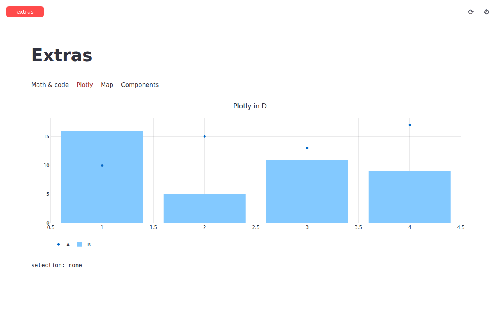

# Data & charts

## DataFrame

`DataFrame` is a small column-oriented table, the stand-in for pandas. Cells are stored as
JSON values, and each column has a type (`integer`, `number`, `text`, `boolean`, `date`,
`datetime` or `object`) that drives formatting, sorting, editing and charts.

### Creating frames

<!-- compile -->
```d
import streamlitd;

struct Sale { string city; int units; double price; Date day; }

void app(St st)
{
    // from structs: one column per field (compile-time introspection)
    auto a = DataFrame.fromStructs([Sale("Almaty", 3, 1.5, Date(2024, 1, 2)), Sale("Astana", 5, 2.0, Date(2024, 1, 3))]);

    // column by column
    auto b = new DataFrame()
        .addColumn("x", [1, 2, 3])
        .addColumn("label", ["a", "b", "c"]);
    b.appendRow(4, "d");

    // from CSV (types are inferred) and from JSON records
    auto c = DataFrame.fromCsv("name,age\nAnn,31\nBob,25\n");
    auto d = DataFrame.fromJson(parseJsonString(`[{"k": 1, "v": "x"}]`), ["k", "v"]);

    st.write(a, b, c, d);
}

mixin StreamlitMain!app;
```

`DataFrame.readCsv(path)` reads a file. Pass `separator: ';'` for other delimiters.
`fromJson` takes an optional column order, because JSON objects do not keep key order.

### Transforming

All transformations return **new** frames:

<!-- wrap -->
```d
auto df = new DataFrame()
    .addColumn("region", ["N", "S", "N", "E"])
    .addColumn("units", [10, 4, 7, 3])
    .addColumn("price", [2.5, 3.0, 2.5, 4.0]);

auto big = df.filter((Row r) => r.get!int("units") > 5);
auto sorted = df.sortBy("units", false);            // descending
auto top = sorted.head(2);
auto cols = df.select("region", "units");
auto agg = df.groupBy("region", ["units"], "sum");  // sum | mean | count | min | max
auto total = df.sum("units");                       // also mean, min, max
auto units = df.column!int("units");                 // typed column → int[]
foreach (i, row; df)
    st.text(row.get!string("region") ~ ": " ~ row["units"].toString);
st.downloadButton("CSV", df.toCsv(), "data.csv");
```

Other operations: `tail`, `slice(from, to)`, `drop(cols...)`, `rename(from, to)`,
`setCell(row, col, Json)`, `cell(row, col)`, `rawColumn`, `columns`, `types`, `length`,
`width`, `dup`, `toRecords()` (JSON array of objects) and `toJson()`.

## Showing data

<!-- wrap -->
```d
auto df = new DataFrame().addColumn("a", [1, 2, 3]).addColumn("b", ["x", "y", "z"]);
st.dataframe(df, height: 300, hideIndex: true);   // interactive: sort, search, CSV export
st.table(df.head(2));                               // static table
st.write(df);                                       // same as st.dataframe
st.json(df.toRecords(), expanded: false);
```


## Editable tables: `st.dataEditor`

<!-- wrap -->
```d
auto todo = new DataFrame()
    .addColumn("task", ["Write code", "Test"])
    .addColumn("done", [true, false])
    .addColumn("hours", [3, 1]);
auto edited = st.dataEditor(todo, numRows: "dynamic", disabled: ["task"], key: "todo");
st.write("Hours left:", edited.filter((Row r) => !r.get!bool("done")).sum("hours"));
```

- `numRows: "dynamic"` lets users add and delete rows.
- `disabled:` lists read-only columns; `disabledAll: true` makes the whole table read-only.
- Cell editors follow the column type: checkbox for booleans, number input for numbers, date
  input for dates.
- The return value is the **edited** frame. The original is not modified.


## Simple charts

The four simple chart types take a frame plus optional `x`, `y` (one or more columns), `color`
and `height`. They render with Vega-Lite, which is bundled, and follow the active
[design style](theming.md).

<!-- wrap -->
```d
auto df = new DataFrame()
    .addColumn("day", [1, 2, 3, 4])
    .addColumn("sales", [10.0, 14, 9, 17])
    .addColumn("costs", [7.0, 8, 8, 9])
    .addColumn("team", ["A", "B", "A", "B"]);

st.lineChart(df, x: "day", y: ["sales", "costs"]);        // several series → legend
st.areaChart(df, x: "day", y: ["sales", "costs"], stack: false);
st.barChart(df, x: "team", y: ["sales"], horizontal: true);
st.scatterChart(df, x: "costs", y: ["sales"], color: "team", size: "day");
st.lineChart(df, x: "day", y: ["sales"], color: "#ff4b4b", height: 200, xLabel: "Day", yLabel: "€");
```

- Without `x`, the row index is used.
- Without `y`, every numeric column except `x` is used.
- `color` is either a column name (a series per value) or a fixed `#hex` color.
- Date columns become time axes.
- Line and scatter charts support zoom and pan with the mouse wheel and drag.


## Vega-Lite

Pass any [Vega-Lite](https://vega.github.io/vega-lite/) spec. If you give a frame, it becomes
the spec's data:

<!-- wrap -->
```d
auto df = new DataFrame().addColumn("product", ["A", "B", "C"]).addColumn("revenue", [5.0, 3, 2]);
st.vegaLiteChart(`{
    "mark": {"type": "arc", "innerRadius": 50},
    "encoding": {
        "theta": {"field": "revenue", "type": "quantitative"},
        "color": {"field": "product", "type": "nominal"}
    }
}`, df);
```

Altair users can export their chart with `chart.to_json()` and pass the result here.

## Plotly

<!-- wrap -->
```d
auto sel = st.plotlyChart(`{
    "data": [{"type": "scatter", "mode": "markers", "x": [1, 2, 3], "y": [4, 1, 6]}],
    "layout": {"title": {"text": "Plotly in D"}}
}`, key: "plt", onSelect: "rerun");
if (sel.type == Json.Type.object)
    st.write("Selected points:", sel["points"].length);
```

- The figure is plain Plotly JSON. In Python, `fig.to_json()` produces it, so existing figures
  can be ported by building the same JSON in D or by loading it from a file.
- `theme: "streamlit"` (the default) applies the active design style and color scheme: fonts, colors and
  transparent background. Pass `theme: null` for Plotly's default look.
- `onSelect: "rerun"` makes the chart a widget. Clicking or lasso-selecting reruns the app, and the
  call returns `{"points": [{curveNumber, pointIndex, x, y}, ...]}`.
- plotly.js (about 4.5 MB) is bundled and only loaded by pages that use it.



## Maps

<!-- wrap -->
```d
auto cities = new DataFrame()
    .addColumn("city", ["Almaty", "Astana"])
    .addColumn("lat", [43.2389, 51.1694])
    .addColumn("lon", [76.8897, 71.4491])
    .addColumn("radius_m", [40_000.0, 30_000]);
st.map(cities, size: "radius_m", color: "#0068c9", height: 400);
```

- The latitude and longitude columns are detected automatically (`lat`/`latitude`,
  `lon`/`lng`/`longitude`), or can be named with `latitude:` and `longitude:`.
- `size` names a column with the radius in meters; `radius:` sets one radius for all points.
- `color` is a hex color or a column of hex colors.
- `zoom:` fixes the zoom level; by default the map fits all points.

Tiles come from OpenStreetMap by default, which needs internet access in the **browser**. For
offline or internal use, point the map at your own tile server:

```toml
# .streamlitd/config.toml
[map]
tileUrl = "https://tiles.internal.example.com/{z}/{x}/{y}.png"
attribution = "© Internal maps"
```


## Images, audio, video, files

<!-- wrap -->
```d
st.image("https://dlang.org/images/dlogo.svg", caption: "From a URL", width: 120);
st.image(cast(const(ubyte)[]) `<svg xmlns="http://www.w3.org/2000/svg" width="40" height="40"><circle cx="20" cy="20" r="18" fill="red"/></svg>`);

if (auto f = st.fileUploader("Upload a CSV", ["csv"]))
{
    auto df = DataFrame.fromCsv(f.text);
    st.write(f.name, "has", df.length, "rows");
}
foreach (f; st.fileUploaderMulti("Images", ["png", "jpg"]))
    st.image(f.bytes, caption: f.name);

st.downloadButton("Download report", "a,b\n1,2\n", "report.csv", "text/csv");
```

The upload limit is set by `--max-upload-mb` or `[server] maxUploadSize` (default 200 MB).
