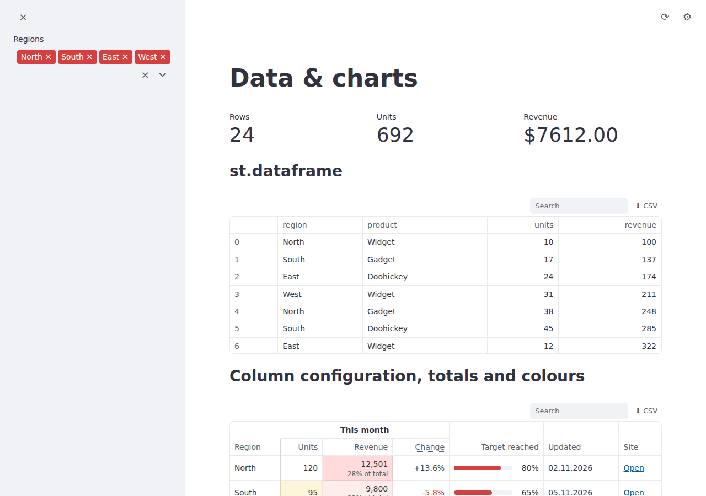
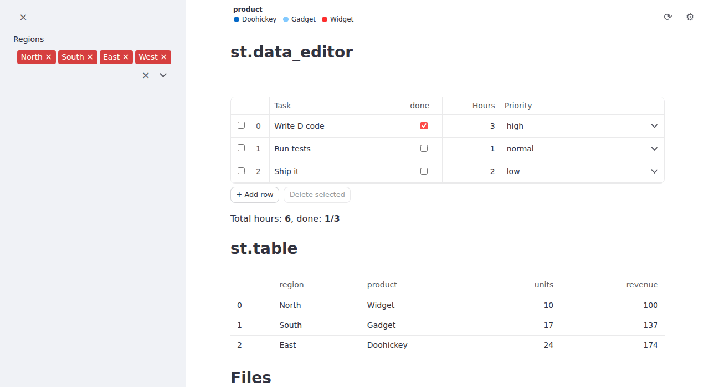
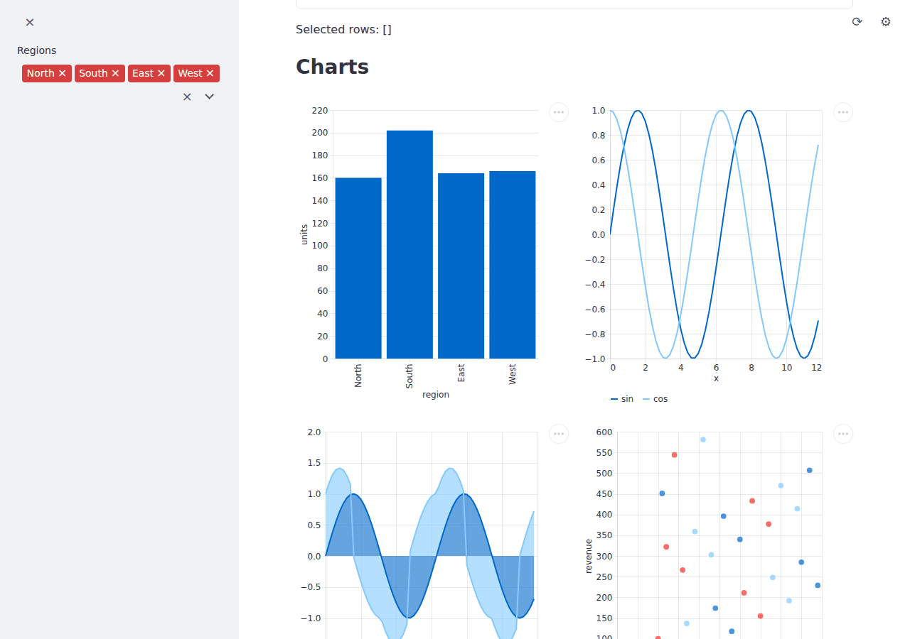
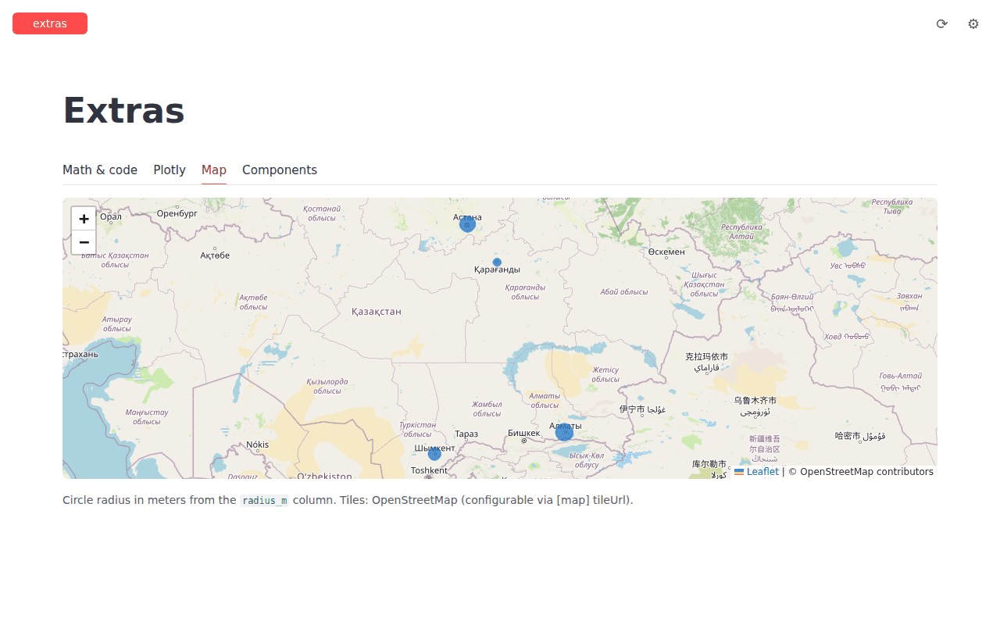

# Data & charts

## DataFrame

`DataFrame` is a small column-oriented table, the stand-in for pandas. Cells are stored as
JSON values, and each column has a type (`integer`, `number`, `text`, `boolean`, `date`,
`datetime` or `object`) that drives formatting, sorting, editing and charts.

### Creating frames

<!-- compile -->
```d
import streamlitd;

struct Sale { string city; int units; double price; Date day; }

void app(St st)
{
    // from structs: one column per field (compile-time introspection)
    auto a = DataFrame.fromStructs([Sale("Almaty", 3, 1.5, Date(2024, 1, 2)), Sale("Astana", 5, 2.0, Date(2024, 1, 3))]);

    // column by column
    auto b = new DataFrame()
        .addColumn("x", [1, 2, 3])
        .addColumn("label", ["a", "b", "c"]);
    b.appendRow(4, "d");

    // from CSV (types are inferred) and from JSON records
    auto c = DataFrame.fromCsv("name,age\nAnn,31\nBob,25\n");
    auto d = DataFrame.fromJson(parseJsonString(`[{"k": 1, "v": "x"}]`), ["k", "v"]);

    st.write(a, b, c, d);
}

mixin StreamlitMain!app;
```

`DataFrame.readCsv(path)` reads a file. Pass `separator: ';'` for other delimiters.
`fromJson` takes an optional column order, because JSON objects do not keep key order.

### Transforming

All transformations return **new** frames:

<!-- wrap -->
```d
auto df = new DataFrame()
    .addColumn("region", ["N", "S", "N", "E"])
    .addColumn("units", [10, 4, 7, 3])
    .addColumn("price", [2.5, 3.0, 2.5, 4.0]);

auto big = df.filter((Row r) => r.get!int("units") > 5);
auto sorted = df.sortBy("units", false);            // descending
auto top = sorted.head(2);
auto cols = df.select("region", "units");
auto agg = df.groupBy("region", ["units"], "sum");  // sum | mean | count | min | max
auto total = df.sum("units");                       // also mean, min, max
auto units = df.column!int("units");                 // typed column → int[]
foreach (i, row; df)
    st.text(row.get!string("region") ~ ": " ~ row["units"].toString);
st.downloadButton("CSV", df.toCsv(), "data.csv");
```

Other operations: `tail`, `slice(from, to)`, `drop(cols...)`, `rename(from, to)`,
`setCell(row, col, Json)`, `cell(row, col)`, `rawColumn`, `columns`, `types`, `length`,
`width`, `dup`, `toRecords()` (JSON array of objects) and `toJson()`.

## Showing data

<!-- wrap -->
```d
auto df = new DataFrame().addColumn("a", [1, 2, 3]).addColumn("b", ["x", "y", "z"]);
st.dataframe(df, height: 300, hideIndex: true);   // interactive: sort, search, CSV export
st.table(df.head(2));                               // static table
st.write(df);                                       // same as st.dataframe
st.json(df.toRecords(), expanded: false);
```



## Column configuration, totals and colours

`columnConfig:` (Streamlit's `column_config`) sets, per column, the header label, a tooltip,
the display format, the width, pinned or hidden, and colours. `totals:` adds a row pinned at the
bottom, and `cellStyle:` colours single cells (the job pandas' Styler does in Python). They work
in `st.dataframe`, `st.table` and, for the editors, `st.dataEditor`.

<!-- wrap -->
```d
alias C = ColumnConfig;
auto df = new DataFrame()
    .addColumn("region", ["North", "South"])
    .addColumn("revenue", [12_500.5, 9_800.0])
    .addColumn("share", [56.0, 44.0])
    .addColumn("change", [13.6, -5.8])
    .addColumn("target", [80, 65])
    .addColumn("updated", ["2026-11-02", "2026-11-05"]);
st.dataframe(df, hideIndex: true, columnConfig: [
    "region":  C.text("Region", pinned: true),
    "revenue": C.number("Revenue", format: "%,.0f", background: "heat", detailColumn: "share", group: "This month"),
    "share":   C.number(format: "%.0f%% of total", hidden: true),   // shown under the revenue
    "change":  C.number("Change", format: "%+.1f%%", color: "sign", help: "vs last month", group: "This month"),
    "target":  C.progress("Target", min: 0, max: 100, format: "%d%%"),
    "updated": C.date("Updated", format: "DD.MM.YYYY"),
], totals: ["region": "Total", "revenue": "sum", "change": "mean"],
   cellStyle: (size_t row, string col, Json v) => col == "change" && v.get!double < -5 ? "bg:error bold" : null);
```

**Column types** (`ColumnConfig.…`):

| Type | Shows | Editor (`dataEditor`) |
|---|---|---|
| `text` | text | text field (`maxChars`, `required`) |
| `number` | formatted number | number field (`min`, `max`, `step`) |
| `date`, `datetime`, `time` | formatted date/time | date picker (`date`) |
| `checkbox` | ✓ | checkbox |
| `select(options)` | text | themed drop-down; `required: true` removes the empty choice |
| `progress(min, max)` | a bar with the value | read-only |
| `link(displayText)` | a link (opens in a new tab) | read-only |
| `column(...)` | type from the data; only label, help, width, group | as the data type |
| `hide()` | not shown | — |

**Fields every type takes:**
- `label`, `help` (a header tooltip);
- `width` (`"small"`, `"medium"`, `"large"` or pixels);
- `pinned` (stays at the left while scrolling sideways; pinned columns move to the front);
- `hidden`, `disabled` (read-only in the editor);
- `group` (adjacent columns with the same group share a header above them).

**Formats** change only what is shown; sorting and totals use the values.
- numbers: printf style (`"%d"`, `"%.1f"`, `"%+d"`, `"%,.0f"` with thousands separators,
  `"%.1f%%"`, any text around it), or `"localized"`, `"plain"`, `"percent"` (×100),
  `"compact"` (12.5K), `"dollar"`, `"euro"`, `"scientific"`;
- dates and times: `"DD.MM.YYYY"`, `"MM.YYYY"`, `"YYYY-MM-DD HH:mm"`, `"D MMM YYYY"`, … or
  `"localized"` (the viewer's language).

**Colours** use the theme, so they are readable in every color scheme and in dark mode:
- `color: "sign"` colours positive values green and negative values red (also the sums of tree
  groups and the totals row);
- `color:` and `background:` also take `"success"`, `"warning"`, `"error"`, `"info"`, `"muted"`,
  `"primary"` or a hex colour;
- `background: "heat"` shades from light to the theme's primary colour between the column's
  smallest and largest value (or `min`/`max`);
- `cellStyle` returns tokens for single cells: `"bg:success"`, `"text:error"`, `"bold"`,
  `"italic"`, `"bg:#fff3cd"`, several separated by spaces, or null.

**More:**
- `totals:` takes `"sum"`, `"mean"`, `"min"`, `"max"`, `"count"`, or any other text (shown as
  it is, e.g. `"Total"`). The totals row stays at the bottom while scrolling and sorting, and
  is computed over the rows the search shows.
- `maxHeight: 600` lets a table grow with its rows up to that height (`height:` is a fixed
  height).
- Header buttons sort (keyboard: Tab, Enter).
- Column names in `columnConfig` and `totals` are checked: a typo is an error.

## Selecting rows and cells

With `onSelect: "rerun"` a table is a widget: clicking a row reruns the app and `dataframe`
returns the selection (Streamlit's `on_select="rerun"`).

<!-- wrap -->
```d
auto suppliers = new DataFrame()
    .addColumn("name", ["ACME", "Globex", "Initech"])
    .addColumn("debt", [1_200.0, 650.0, 980.0])
    .addColumn("guid", ["s1", "s2", "s3"]);
auto sel = st.dataframe(suppliers, onSelect: "rerun", rowKey: "guid", key: "suppliers",
    columnConfig: ["guid": ColumnConfig.hide()]);
if (!sel.empty)
    st.write("Open supplier", sel.keys[0].get!string, "— row", sel.rows[0]);
```

| `selectionMode` | Selects | Returns |
|---|---|---|
| `"single-row"` (default) | one row; clicking it again clears it | `sel.rows`, `sel.keys` |
| `"multi-row"` | rows with checkboxes (and a "select all"); Shift-click selects a range | `sel.rows`, `sel.keys` |
| `"single-cell"` | one cell | `sel.cells[0].row`, `sel.cells[0].column` |

- `sel.rows` are indices into the frame you passed, whatever the viewer's sorting and search.
- `rowKey:` names a column whose values identify the rows, and fills `sel.keys`. The selection
  then also survives the frame being filtered or reordered between runs, and follows the keys: when
  selected rows leave the frame (deleted, filtered out), they leave the selection too, instead of
  their row numbers selecting whatever rows came next. Without a `rowKey`, the selection is cleared
  when the number of rows changes.
- Keyboard: Tab into the table, ↑/↓/Home/End move, Space or Enter selects. In `single-cell`
  mode, ←/→ move between cells.
- The selected row keeps the focus after the rerun. A table with a `key` keeps its scroll position
  across reruns (and a tree its open groups).
- In tests, use `at.selectRows("suppliers", 1)` and `at.selectGroup(key, "Ann")` (see
  [Testing](testing.md)).

## Tree rows

`groupBy:` turns a flat frame into a tree that opens and closes, with group values computed by
`totals`:

<!-- wrap -->
```d
auto brands = new DataFrame()
    .addColumn("manager", ["Ann", "Ann", "Bob"])
    .addColumn("supplier", ["ACME", "Globex", "Initech"])
    .addColumn("brand", ["Rocket", "Gizmo", "Stapler"])
    .addColumn("amount", [1_200.0, 980.0, 210.0]);
auto pick = st.dataframe(brands, groupBy: ["manager", "supplier"], expanded: 1, onSelect: "rerun", key: "tree",
    totals: ["brand": "Total", "amount": "sum"]);
if (pick.group.length)
    st.write("Group:", pick.group.join(" › "));    // e.g. ["Ann", "ACME"]
```

- The `groupBy` columns become the levels (they are not shown as columns). Group rows show their
  name, the number of rows, and each column aggregated with its `totals` spec (`sum`, `mean`,
  `min`, `max`, `count`). The `totals` row at the bottom is the grand total.
- **Expanding:**
  - `expanded: n` opens the first `n` levels at first;
  - **Expand all** and **Collapse all** sit above the table;
  - the open groups are remembered across reruns;
  - while searching, groups with matching rows open.
- Sorting orders groups by their aggregated values (or their names, for the first column), and
  rows within their group.
- With `onSelect: "rerun"`, clicking a group row selects it (`pick.group`); its triangle opens
  it. Without `onSelect`, clicking a group row opens or closes it.
- Keyboard: → opens a group (or moves into it), ← closes it (or moves to its parent).

## Editable tables: `st.dataEditor`

<!-- wrap -->
```d
auto todo = new DataFrame()
    .addColumn("task", ["Write code", "Test"])
    .addColumn("done", [true, false])
    .addColumn("hours", [3, 1]);
auto edited = st.dataEditor(todo, numRows: "dynamic", disabled: ["task"], key: "todo");
st.write("Hours left:", edited.filter((Row r) => !r.get!bool("done")).sum("hours"));
```

- `numRows: "dynamic"` lets users add and delete rows. `maxRows:` caps the table's size: "+ Add
  row" stops there, and the server ignores rows a client adds beyond it (set it whenever the rows
  end up in a shared store).
- `disabled:` lists read-only columns; `disabledAll: true` makes the whole table read-only.
- Cell editors follow the column type: checkbox for booleans, number input for numbers, date
  picker for dates.
- `columnConfig:` chooses editors and rules: `ColumnConfig.select(options)`,
  `number(min:, max:, step:)`, `text(maxChars:, required: true)`, `disabled: true`. Values a
  column does not allow are rejected in the browser and dropped on the server too.
- The return value is the **edited** frame. The original is not modified.

<!-- wrap -->
```d
auto edited = st.dataEditor(new DataFrame()
        .addColumn("task", ["Write code"]).addColumn("hours", [3]).addColumn("priority", ["high"]),
    numRows: "dynamic", key: "plan", columnConfig: [
        "hours": ColumnConfig.number("Hours", min: 0, max: 24),
        "priority": ColumnConfig.select("Priority", ["high", "normal", "low"], required: true),
    ]);
```



## Simple charts

The four simple chart types take a frame plus optional `x`, `y` (one or more columns), `color`
and `height`. They render with Vega-Lite, which is bundled, and follow the active
[design style](theming.md).

<!-- wrap -->
```d
auto df = new DataFrame()
    .addColumn("day", [1, 2, 3, 4])
    .addColumn("sales", [10.0, 14, 9, 17])
    .addColumn("costs", [7.0, 8, 8, 9])
    .addColumn("team", ["A", "B", "A", "B"]);

st.lineChart(df, x: "day", y: ["sales", "costs"]);        // several series → legend
st.areaChart(df, x: "day", y: ["sales", "costs"], stack: false);
st.barChart(df, x: "team", y: ["sales"], horizontal: true);
st.scatterChart(df, x: "costs", y: ["sales"], color: "team", size: "day");
st.lineChart(df, x: "day", y: ["sales"], color: "#ff4b4b", height: 200, xLabel: "Day", yLabel: "€");
```

- Without `x`, the row index is used.
- Without `y`, every numeric column except `x` is used.
- `color` is either a column name (a series per value) or a fixed `#hex` color.
- `stack: false` puts the bars of several series side by side (areas overlap).
- Date and time columns become time axes, shown in the viewer's time zone; times within one day get
  clock labels (`14:05:30`), e.g. for a live chart of the last minutes.
- Line and scatter charts support zoom and pan with the mouse wheel and drag.



## Vega-Lite

Pass any [Vega-Lite](https://vega.github.io/vega-lite/) spec. If you give a frame, it becomes
the spec's data:

<!-- wrap -->
```d
auto df = new DataFrame().addColumn("product", ["A", "B", "C"]).addColumn("revenue", [5.0, 3, 2]);
st.vegaLiteChart(`{
    "mark": {"type": "arc", "innerRadius": 50},
    "encoding": {
        "theta": {"field": "revenue", "type": "quantitative"},
        "color": {"field": "product", "type": "nominal"}
    }
}`, df);
```

Altair users can export their chart with `chart.to_json()` and pass the result here.

## Plotly

<!-- wrap -->
```d
auto sel = st.plotlyChart(`{
    "data": [{"type": "scatter", "mode": "markers", "x": [1, 2, 3], "y": [4, 1, 6]}],
    "layout": {"title": {"text": "Plotly in D"}}
}`, key: "plt", onSelect: "rerun");
if (sel.type == Json.Type.object)
    st.write("Selected points:", sel["points"].length);
```

- The figure is plain Plotly JSON. In Python, `fig.to_json()` produces it, so existing figures
  can be ported by building the same JSON in D or by loading it from a file.
- `theme: "streamlit"` (the default) applies the active design style and color scheme: fonts, colors and
  transparent background. Pass `theme: null` for Plotly's default look.
- `onSelect: "rerun"` makes the chart a widget. Clicking or lasso-selecting reruns the app, and the
  call returns `{"points": [{curveNumber, pointIndex, x, y}, ...]}`.
- plotly.js (about 4.5 MB) is bundled and only loaded by pages that use it.


## Maps

<!-- wrap -->
```d
auto cities = new DataFrame()
    .addColumn("city", ["Almaty", "Astana"])
    .addColumn("lat", [43.2389, 51.1694])
    .addColumn("lon", [76.8897, 71.4491])
    .addColumn("radius_m", [40_000.0, 30_000]);
st.map(cities, size: "radius_m", color: "#0068c9", height: 400);
```

- The latitude and longitude columns are detected automatically (`lat`/`latitude`,
  `lon`/`lng`/`longitude`), or can be named with `latitude:` and `longitude:`.
- `size` names a column with the radius in meters; `radius:` sets one radius for all points.
- `color` is a hex color or a column of hex colors.
- `zoom:` fixes the zoom level; by default the map fits all points.

Tiles come from OpenStreetMap by default, which needs internet access in the **browser**. For
offline or internal use, point the map at your own tile server:

```toml
# .streamlitd/config.toml
[map]
tileUrl = "https://tiles.internal.example.com/{z}/{x}/{y}.png"
attribution = "© Internal maps"
```



## Images, audio, video, files

<!-- wrap -->
```d
st.image("https://dlang.org/images/dlogo.svg", caption: "From a URL", width: 120);
st.image(cast(const(ubyte)[]) `<svg xmlns="http://www.w3.org/2000/svg" width="40" height="40"><circle cx="20" cy="20" r="18" fill="red"/></svg>`);

if (auto f = st.fileUploader("Upload a CSV", ["csv"]))
{
    auto df = DataFrame.fromCsv(f.text);
    st.write(f.name, "has", df.length, "rows");
}
foreach (f; st.fileUploaderMulti("Images", ["png", "jpg"]))
    st.image(f.bytes, caption: f.name);

st.downloadButton("Download report", "a,b\n1,2\n", "report.csv", "text/csv");

// built only when clicked, not on every run (e.g. a large Excel export)
DataFrame buildReport() { return new DataFrame().addColumn("a", [1, 2]); }
st.downloadButton("Export", () => buildReport().toCsv(), "report.csv", "text/csv");
```

With a function instead of data, the file is built when the viewer clicks, on a thread of its own,
so a slow export neither slows down every run nor holds up other users. The link works while the
button is on the page; it does not rerun the app.

**Text people typed, opened in Excel.** A cell such as `=HYPERLINK("http://…")` runs as a formula
when the CSV is opened in a spreadsheet ("CSV injection"). `toCsv(',', true)` puts a `'` before
text that starts with `=`, `+`, `-`, `@`, Tab or CR (numbers stay as they are). Use it for exports
of data that users typed: ticket titles, names, comments.

The upload limit is set by `--max-upload-mb` or `[server] maxUploadSize` (default 200 MB).
