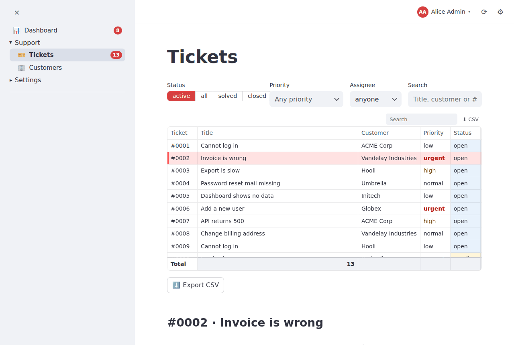
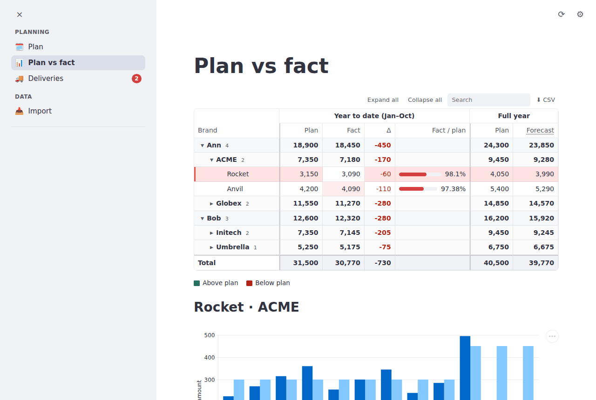
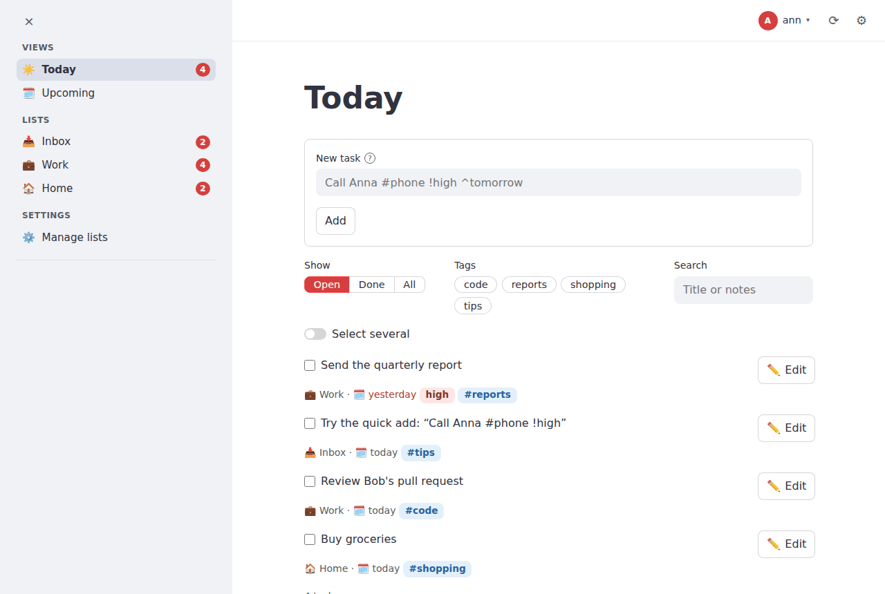
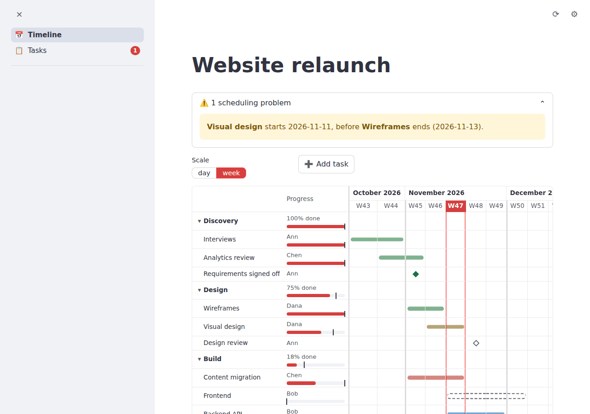
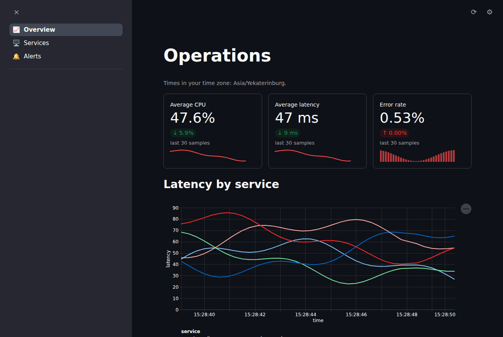

# Example apps

The [`examples/`](../examples) folder has two kinds of apps:

- **Small examples** (`hello`, `widgets`, `data`, …) show one area each, in a single file.
  [examples/README.md](../examples/README.md) lists every example with a screenshot.
- **Larger apps** (this page) are realistic, multi-page programs of 500–1,100 lines, split into
  modules, with their own unit tests and browser tests. Read them to see how the pieces fit together
  in a real app, and copy their structure for your own.

| App | What it is | Highlights |
|---|---|---|
| [`helpdesk`](#helpdesk) | tickets and customers for a support team | login with roles, a ticket table with selection and a detail panel, nested dialogs, live updates between agents, a JSON API |
| [`planning`](#planning) | purchase planning for a buying department | a yearly plan edited in a table with a review before saving, plan vs fact as a tree, a delivery calendar, a CSV import wizard |
| [`todo`](#todo) | a personal TODO app | sign-up, lists per person, quick add with `#tags`, filters, bulk actions, edit dialogs |
| [`gantt`](#gantt) | a project planner | a Gantt chart with phases, milestones and dependencies, edit dialogs, a table view |
| [`monitor`](#monitor) | a live operations monitor | a background producer pushing to every open page, alerts with rules, a slow source off the event loop |

Run one with:

```sh
cd examples/helpdesk && dub run --compiler=ldc2
```

Then open <http://localhost:8501>. On their first start, the apps create demo data under their
`data/` folder. Each app reads its data file's path from an environment variable
(`HELPDESK_DATA`, `PLANNING_DATA`, `TODO_DATA`, `GANTT_DATA`). The tests use it to start from fresh
data. `planning`, `todo` and `gantt` also take a fixed "today" (`PLANNING_TODAY=2026-11-18`, …),
so their tests always see the same closed months and late tasks.

## helpdesk



A support team's helpdesk. Sign in with the demo login **`alice` / `streamlitd-demo`** (an admin
and agent), or as `bob` (an agent) with the same password.

| Page | What it shows |
|---|---|
| Dashboard | KPI tiles (open tickets with a trend of tickets opened per day, overdue, solved today), tickets by status as a proportion bar, a bar chart, recent activity as a feed |
| Tickets | filters (a required segmented control, a multiselect, a selectbox, a search), a configured table (pinned column, SLA progress bars, colours by status and priority, totals), the selected ticket's details, comments as a timeline, status and assignee changes, an edit dialog whose "Close ticket…" opens a confirmation on top, a CSV export built on click |
| Customers | a data editor with a `select` column for the plan and a `number` column for seats, checked before saving (names unique, emails valid) |
| Users | `st.userAdmin()`, only for the admin role (`st.requireRole("admin")`) |

**Live updates.** Every change goes through the store (`source/helpdesk/store.d`), which then calls
`refreshFragments("helpdesk")`. The ticket list and the dashboard are fragments subscribed to that
topic (`refreshOn: "helpdesk"`), so when Bob closes a ticket, Alice's open page updates at once.

**An API next to the UI.** `source/helpdesk/api.d` adds `GET /api/tickets` (any signed-in user) and
`POST /api/tickets` (the agent role) with `mixin StreamlitMain!(app, routes)`. A ticket posted to the
API shows up on every open page, because the API writes through the same store.

**Navigation.** Badges show the open and overdue counts, sections fold
(`sections: "collapsible"`), and the Users page exists only for admins: the page list is built in
each run.

## planning



Purchase planning in the style of a buying department: suppliers, brands, a monthly plan and the
actual purchases ("fact").

| Page | What it shows |
|---|---|
| Plan | the year's plan in a data editor. Closed months are read-only (`disabled:`), months are grouped under "Closed" and "Open months", the supplier is a required `select`, rows can be added and deleted. "Review & save" lists the changes (added, changed, removed, Δ coloured by sign) in a dialog before they are written. |
| Plan vs fact | a tree table (manager › supplier › brand) with grouped headers ("Year to date", "Full year"), Δ by sign (group sums too), heat on the fact, a progress column, totals; a selected brand shows its months as a grouped bar chart |
| Deliveries | `st.calendarGrid` by week or day: suppliers with their brands, deliveries as markers sized by amount, late ones as red squares, a delivered/expected bar per supplier. A click on a delivery opens it, and "Move date…" opens a second dialog on top. A click on an empty day plans a new delivery there. |
| Import | a four-step wizard (`st.stepper`): upload a CSV (or use the bundled sample) → match unknown supplier names (with a guess) → review the changes (new, changed, skipped for closed months) → apply |

**Two people editing the plan.** The store counts versions. The editor remembers the version its
edits started from. If someone else saves in between, the page says so and offers to load their
version, instead of overwriting it.

**Shipping a file with the app.** The sample CSV is compiled in with `import("sample-plan.csv")`
(`"stringImportPaths": ["data"]` in `dub.json`), so it works wherever the binary runs.

## todo



A TODO app where each person signs up and gets their own lists. Sign up with the demo login
**`alice` / `streamlitd-demo`** (or any other). It needs no configured users:
`[auth] registration = "open"` puts a sign-up link on the login page, passwords are hashed
automatically, and the first account becomes the administrator
([Authentication](authentication.md)).

- **Lists and views.** The sidebar has views (Today, Upcoming) and one page per list. The pages are
  built from the person's data in every run, with open counts as badges.
- **Quick add.** `Call Anna #phone !high ^tomorrow` adds a task with a tag, a priority and a due
  date. The form clears itself after Add (`clearOnSubmit`), and the cursor stays in the field.
- **Tasks.** Each task is a checkbox labelled with its title. Ticking it completes the task. Under it,
  the due date (red when overdue), the priority and the tags are shown as inline badges
  (`:red-badge[high]`, `:blue-badge[#work]`).
- **Filters and pages.** Open/Done/All, tags (pills), a search, and pagination when a list is long.
- **Bulk actions.** "Select several" switches to a table with checkboxes: complete, reopen, move to
  another list, or delete after a confirmation.
- **Edit dialog.** Title, notes, due date, priority, tags (`tagsInput` with suggestions) and list;
  "Delete…" asks again in a dialog on top.
- **Two tabs, one person.** Each person's pages listen to their own topic
  (`refreshOn: "todo:" ~ user`), so a task ticked in one tab disappears from the other.

## gantt



A project planner for a website relaunch.

- **The chart** is a `st.calendarGrid`: phases are rows with their tasks under them, tasks are
  spans, milestones are diamonds. Colours show the status: done, under way, behind (less progress
  than the time passed), late (should have ended), not started. The summary column has progress
  bars with an "expected by today" mark. The scale switches between days and weeks.
- **Editing.** A click on a bar opens the task in a dialog: name, phase, owner, a date range (or one
  day for a milestone), progress, and what it depends on. The dialog warns while you edit when the
  dates clash with a dependency. "Delete…" asks in a dialog on top.
- **Adding.** "Add task", or a click on an empty day, which starts a task there in that row's phase.
- **Checks.** Tasks that start before something they depend on has ended are listed above the
  chart. Moving one task later can create problems further down, and those appear at once.
- **Table view.** The same tasks as a table grouped by phase, with progress bars, late rows marked,
  and a CSV export. A click on a row opens the editor. It opens on the selection change
  (`onChange`), so it stays closed after you close it, even though the row is still selected.

## monitor



A live operations monitor for five services.

- **A producer thread.** `source/monitor/metrics.d` starts one background thread per process
  (through `cacheResource`). It samples every service once a second, keeps the last 120 samples,
  checks the alert rules, and calls `refreshFragments("metrics")`. It also calls
  `refreshFragments("alerts")`, but only when an alert fired. Pages draw from that shared data and
  never poll.
- **Overview.** KPI tiles with sparklines and a rolling chart of all services. The time axis is in
  the viewer's time zone, and the captions use `st.context.timezoneOffset`.
- **Services.** Health colours in a table. The selected service shows its charts, and the selection
  survives the pushed updates (several per second).
- **Alerts.** A feed of fired alerts (open ones highlighted), "Acknowledge all", and the rules in a
  data editor. The navigation badge counts open alerts. The navigation is drawn by full runs, so a
  small fragment subscribed to "alerts" reruns the app when the count changes.
- **A slow source.** The inventory comes from a "legacy system" that blocks for two seconds. It
  runs with `blocking(...)` on a thread of its own, so other viewers on the same worker thread
  don't wait. It sits in a fragment with `runEvery: 5` and
  `refreshWhen: () => version != seen`, so it is asked only when its data changed.

## Structuring a larger app

All five apps share one layout:

```text
examples/<name>/
  dub.json                 targetType executable, mainSourceFile source/app.d
  .streamlitd/config.toml  settings (and secrets.toml with demo users, where needed)
  source/app.d             the shell: page config, navigation, badges, user menu, mixin StreamlitMain
  source/<name>/store.d    the data: types, a store shared by all sessions, demo data
  source/<name>/ui.d       helpers the pages share: column configs, formats, dialogs
  source/<name>/pages/*.d  one module per page: void page(St st)
  source/<name>/tests.d    AppTest unit tests (dub test)
```

**The data layer.** One store object serves every session. It guards its data with a `Mutex`,
writes its file atomically (to `.tmp`, then rename), and tells open pages about changes with
`refreshFragments`. `cacheResource` makes it once per process, and a setter lets tests swap in a
store without a file:

<!-- compile -->
```d
import core.sync.mutex : Mutex;

struct Note { int id; string text; }

final class Notes
{
    private Mutex lock;
    private Note[] notes;
    private bool push;

    this(bool push = true) { lock = new Mutex; this.push = push; }

    Note[] all() { synchronized (lock) return notes.dup; }   // copies: callers can't race

    void add(string text)
    {
        synchronized (lock)
            notes ~= Note(cast(int) notes.length + 1, text);
        // (save to a file here)
        if (push)
            refreshFragments("notes");   // every open page listening to "notes" updates
    }
}

private __gshared Notes testNotes;
Notes notesStore() { return testNotes !is null ? testNotes : cacheResource!makeNotes(); }
private Notes makeNotes() { return new Notes; }
void useNotes(Notes n) { testNotes = n; }   // tests: a store of their own, no push

void notesPage(St st)
{
    st.title("Notes");
    auto fm = st.form("add", clearOnSubmit: true);
    auto text = fm.textInput("New note");
    if (fm.formSubmitButton("Add") && text.length)
        notesStore.add(text);
    // the list reruns by itself when anyone adds a note
    st.fragment((St f) {
        foreach (n; notesStore.all)
            f.write(n.text);
    }, refreshOn: "notes");
}

unittest
{
    import streamlitd.testing : AppTest;
    useNotes(new Notes(false));
    auto at = new AppTest(&notesPage).run();
    at.submitForm("Add", [at.widgetId("text_input", "New note"): Json("Buy milk")]).run();
    assert(notesStore.all.length == 1);
}
```

**Pages as modules.** Each page is a `void page(St st)` in its own module, and `app.d` builds the
navigation in every run. Badges, and pages that depend on the user or the data (the todo app's
lists, the helpdesk's admin page), come out right that way. A page made from data needs a
delegate. Build it in a function that takes the item, not in the loop itself (see
[Pitfalls](#pitfalls)).

**Live updates.** Put what other people's changes affect into fragments with `refreshOn:`. Pick
topics by audience: one for the whole app (`"helpdesk"`), one per person (`"todo:" ~ user`), or one
per kind of change (`"metrics"` every second, `"alerts"` rarely). See
[Core concepts](concepts.md).

**Tests.** `dub test` in an example runs its `tests.d` (dub leaves out `app.d`, the main file). The
tests use a store without a file and drive whole pages with `AppTest`: filters, saving, dialogs
(`paths("dialog")` counts the open ones, `dismissDialog` closes one like ×), table selections,
calendar clicks (`trigger`). The browser tests in `tests/e2e/specs/<name>.spec.js` start each app
with a fresh data file. When tests share an app's data, the spec runs serially; the todo spec
instead signs up a new user per test. [Testing](testing.md) has the details.

## Pitfalls

Things these apps ran into, and their fixes. The first group came from attacking the apps as a
malicious user would:

- **User text rendered as Markdown.** A title like `` became an image that
  every other agent's browser fetched. Wrap what people typed in `escapeMarkdown` wherever it goes
  into Markdown ([User text in Markdown](concepts.md#user-text-in-markdown)).
- **The browser's limits aren't limits.** A client can send any widget value, any number of
  editor rows and any JSON to an API. So the stores check everything again:
  - priorities and customers in the helpdesk API;
  - plan amounts up to 10⁹;
  - task dates within five years;
  - at most 2,000 tasks and 50 lists per person;
  - `dataEditor(maxRows:)`.
- **One bad record broke a shared page.** A task dated 9999-12-31 made the Gantt chart fail for
  everyone. Validate before saving, and draw defensively (the chart clamps its range).
- **Lists that only grow.** Alerts from a flapping rule piled up without end, so they are capped now
  (old acknowledged ones go first).
- **Exports opened in Excel** run `=...` cells as formulas: `toCsv(',', true)`.
- **Matching by name.** Renaming a brand in the plan made it "removed + added" and dropped its
  history. Carry ids through the editor (a hidden `id` column) and match by id.
- **Open sign-up.** It invites scripts: `[auth] signups_per_hour` (default 10 per address) limits
  them, and the todo app caps what one account may store.
- **One file for all data.** The demo stores rewrite one JSON file on every change. That's fine for
  a demo or a team, but with many active users, use a database.

And from building them:

- **A closure over a `foreach` variable.** D closures share the loop variable. A dialog's body,
  a callback or a page built in a loop can run later, when the variable names the last item. The
  todo app once deleted the wrong list this way. Create such closures in a function that takes the
  item as a parameter (`confirmDelete(st, list)`, `listPage(list)`, `toggler(task)`).
- **A dialog opened from session state comes back.** × and Esc close it in the browser, but the
  session value stays, so the next full rerun opens it again. Pass `onDismiss` to clear the value
  ([Dialogs](layout-and-navigation.md#dialogs)).
- **A dialog opened from a selection.** "If a row is selected, open the editor" opens it in every run
  while the row stays selected. Open it in the table's `onChange` instead.
- **Reading after writing in the same run.** A fragment that reads data, then changes it on a
  click, draws what it read before. Call `st.rerun("fragment")` after the change.
- **`new double[n]` holds NaN**, not zeros, in D. Write `a[] = 0` before counting into it.
- **Live chart times.** Give the chart timestamps (`SysTime`), not formatted strings. Samples within
  one second would otherwise share a label and stack.
- **Slow calls.** A call that blocks the thread (a driver without vibe.d support, `Thread.sleep`, a
  long loop) also stalls the other sessions on that worker thread. Wrap it in `blocking(...)`.
