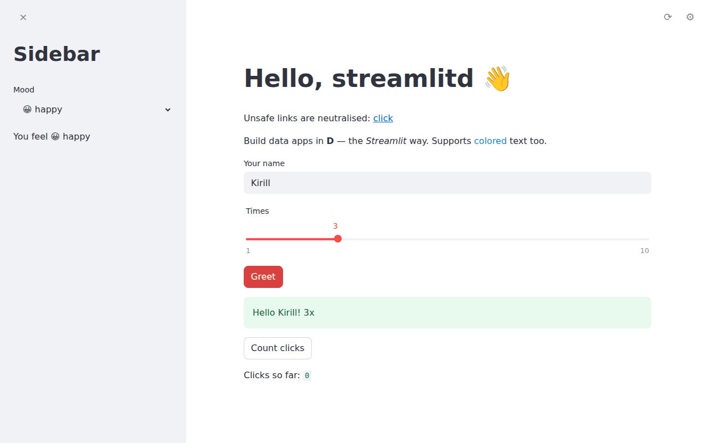

# Getting started

## 1. Install the toolchain

streamlitd needs a D compiler and dub (the D package manager/build tool). Two compilers work:

- **LDC ≥ 1.36**, recommended: optimized, faster binaries. Tested with LDC 1.36 (D frontend 2.106).
- **DMD ≥ 2.106**, the reference compiler: much faster builds, handy while developing. Tested with DMD 2.114.

gdc is not supported: the gdc 13 shipped with Ubuntu 24.04 is too old for vibe.d (and the gdc from
`install.sh` is from 2013).

| OS | Install |
|---|---|
| Ubuntu / Debian | `sudo apt install ldc dub libssl-dev zlib1g-dev` |
| Fedora | `sudo dnf install ldc dub openssl-devel zlib-devel` |
| macOS | `brew install ldc dub` |
| Windows / other | the installer at <https://dlang.org/download.html> (LDC or DMD), or `curl -fsS https://dlang.org/install.sh \| bash -s ldc` (or `-s dmd`) |

`install.sh` puts the compiler in `~/dlang/`; run `source ~/dlang/<compiler>/activate` in each new
shell (it also sets `DC`).

> **Always pass `--compiler=ldc2` (or `--compiler=dmd`)** to dub, or set `DC`. On some systems dub
> picks `gdc` by default, which is too old for vibe.d. The examples in these docs use `ldc2`.

## 2. Create a project

streamlitd is not on the dub registry yet. Depend on it by path (or by git URL):

```sh
mkdir myapp && cd myapp
cat > dub.json <<'JSON'
{
    "name": "myapp",
    "targetType": "executable",
    "dependencies": {
        "streamlitd": { "path": "../streamlitd" }
    }
}
JSON
mkdir source
```

To use a git checkout instead of a local path, use `"streamlitd": { "repository": "git+https://your.git.server/streamlitd.git", "version": "<commit-sha>" }`.

## 3. Write your first app

`source/app.d`:

<!-- compile -->
```d
import streamlitd;
import std.conv : to;

void app(St st)
{
    st.title("Hello, streamlitd 👋");
    st.write("This is **markdown**, rendered in the browser.");

    auto name = st.textInput("Your name", "World");
    auto times = st.slider("Times", 1, 10, 3);

    if (st.button("Greet", type: "primary"))
        st.success("Hello " ~ name ~ "! (" ~ times.to!string ~ "×)");

    with (st.sidebar)
    {
        header("Sidebar");
        auto mood = selectbox("Mood", ["😀 happy", "😐 neutral", "😢 sad"]);
        write("You feel", mood);
    }
}

mixin StreamlitMain!app;   // generates main(); parses --port, --host, ...
```

## 4. Run it

```sh
dub run --compiler=ldc2
```

```
  You can now view your streamlitd app in your browser.

  Local URL: http://localhost:8501/
```

Open the URL. Type a name, move the slider, click **Greet**. Every interaction **reruns `app`
from the top**, and the page updates with the new output. That is the whole programming model.
[Core concepts](concepts.md) explains it in detail.



## 5. Useful flags

Arguments after `--` go to your app:

```sh
dub run --compiler=ldc2 -- --port 8080 --design terminal --color-scheme ocean
./myapp --help            # all options
```

| Flag | Meaning |
|---|---|
| `--port`, `-p` | port (default 8501) |
| `--host` | bind address (default `0.0.0.0`) |
| `--design`, `--color-scheme`, `--theme-mode` | design style (terminal, retro, win95, xp, …), color scheme and `auto`/`light`/`dark` |
| `--base-url-path` | serve under a prefix such as `/myapp` |
| `--script-threads` | worker threads for scripts (`-1` = CPU cores, `0` = single-threaded) |
| `--quiet`, `-q` | no startup banner |

The full list is in [Configuration](configuration.md).

## 6. Project layout

```
myapp/
├── dub.json
├── source/app.d              # your app (you can split it into more modules)
├── data/                     # files your app reads (paths are relative to the working directory)
└── .streamlitd/
    ├── config.toml           # optional settings (port, theme, ...)
    └── secrets.toml          # optional secrets; never commit this file
```

## 7. Editor support

- **VS Code:** the *code-d* extension (completion, go-to-definition, dub integration).
- **IntelliJ:** the *Intellij-DLanguage* plugin.
- The [API reference](api-reference.md) lists every function with its parameters. Most optional
  parameters are named, as in Python: `st.slider("x", 0, 10, 5, step: 2, key: "s")`.

## Next

- Build a real dashboard in the [tutorial](tutorial.md).
- Coming from Python? Keep the [cheat sheet](cheatsheet.md) open.
