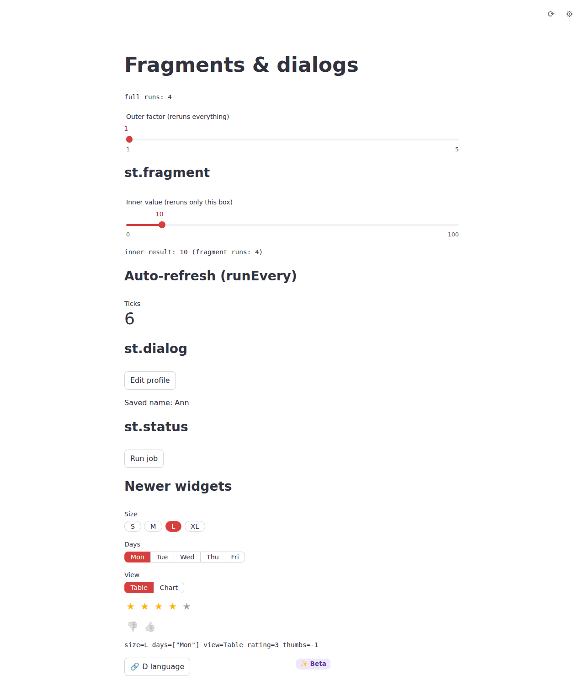
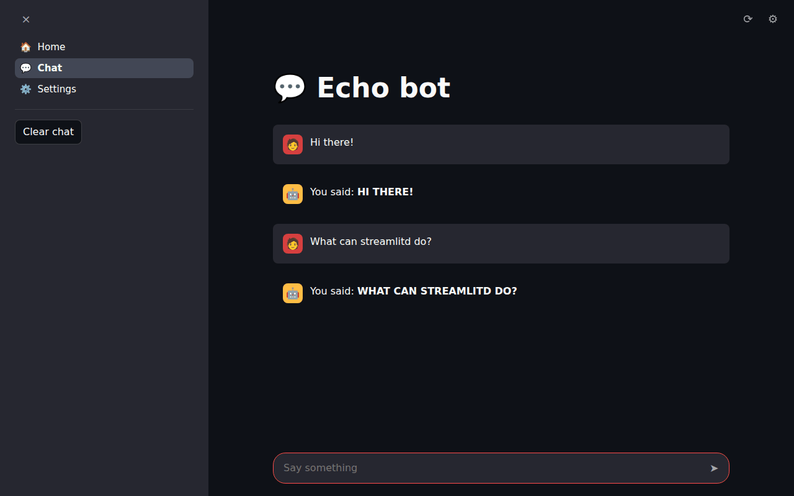

# Layout & navigation

Every layout call returns a new `St` (or an array of them) that draws into the container.
Use the returned object directly, or with `with`:

<!-- wrap -->
```d
auto left = st.columns(2)[0];
left.write("via the object");
with (st.container(border: true))
    write("via with");
```

## Sidebar

<!-- wrap -->
```d
st.sidebar.title("Filters");
with (st.sidebar)
{
    auto year = selectbox("Year", ["2023", "2024"]);
    write("Selected", year);
}
```

The sidebar appears as soon as something is drawn into it. Users can collapse it, and
`setPageConfig(initialSidebarState: "collapsed")` starts it collapsed.

## Columns

<!-- wrap -->
```d
auto c = st.columns(3);                                         // equal widths
c[0].metric("Temperature", "70 °F", "1.2 °F");
auto w = st.columns([2.0, 1], gap: "large", verticalAlignment: "center", border: true);
w[0].write("twice as wide");
```

On narrow screens (phones), columns stack vertically.

## Tabs, expanders, containers, popovers

<!-- wrap -->
```d
auto t = st.tabs(["Chart", "Data"]);
t[0].write("first tab");
t[1].write("second tab");

with (st.expander("Show details", expanded: false))
    write("hidden until opened");

auto box = st.container(border: true, height: 200);  // height > 0: scrollable
box.write("inside a bordered, scrollable container");

with (st.popover("Settings"))
    checkbox("Advanced mode");
```

Tabs keep their selection across reruns, and expanders keep their open/closed state.


## Placeholders: `st.empty`

`st.empty()` reserves one slot. Every call on it **replaces** the content, which is handy for
progress messages:

<!-- wrap -->
```d
auto slot = st.empty();
slot.info("Loading...");
st.sleep(0.5);
slot.success("Done");          // replaces the info box
```

## Forms

<!-- wrap -->
```d
auto f = st.form("order", clearOnSubmit: true, border: true);
auto item = f.selectbox("Item", ["Coffee", "Tea"]);
auto qty = f.numberInput("Quantity", 1, minValue: 1);
if (f.formSubmitButton("Order", type: "primary"))
    st.success("Ordered " ~ item);
```

Widgets in a form do not rerun the app until the submit button is pressed. See
[Core concepts](concepts.md#forms).


## Dialogs

A dialog is a modal window. It usually opens from a button and runs as a fragment, so its widgets
rerun only the dialog:

<!-- wrap -->
```d
if (st.button("Edit profile"))
    st.dialog("Edit profile", (St d) {
        auto name = d.textInput("Display name", st.session.get!string("name", "Ann"));
        if (d.button("Save", type: "primary"))
        {
            st.session["name"] = name;
            st.rerun();               // a full rerun closes the dialog
        }
    }, width: "small");
```

- The user can close it with ×, Escape or a click outside (`dismissible: false` prevents that).
- A dialog stays open while its own widgets are used, and closes on the next full rerun in which
  it isn't opened again.


## Status containers

<!-- wrap -->
```d
auto s = st.status("Downloading data...", expanded: true);
s.write("Fetched 3 files");
s.update(label: "Done", state: "complete", expanded: 0);   // states: running, complete, error
```

`StatusContainer` behaves like a container (`s.write`, `with (s) { ... }`) and adds `update`.

## Fragments

`st.fragment((St f) { ... }, runEvery: seconds)` draws a part of the page that reruns
independently. See [Core concepts → Fragments](concepts.md#fragments).



## Chat layout

<!-- wrap -->
```d
foreach (m; st.session.get!(string[][])("history"))
    st.chatMessage(m[0]).markdown(m[1]);
if (auto prompt = st.chatInput("Ask something"))
{
    st.chatMessage("user").markdown(prompt);
    st.chatMessage("assistant").markdown("Echo: " ~ prompt);
    st.session["history"] = st.session.get!(string[][])("history") ~ [["user", prompt], ["assistant", "Echo: " ~ prompt]];
}
```

A `chatInput` called on the main area is pinned to the bottom of the page. The names `"user"` and
`"assistant"` get default avatars; pass `avatar: "🦊"` for your own.



## Multipage apps

<!-- compile -->
```d
import streamlitd;

void home(St st)
{
    st.title("Home");
    st.pageLink("reports", "Go to reports", "📊");
    if (st.button("Open settings"))
        st.switchPage("Settings");
}

void reports(St st) { st.title("Reports"); }
void settings(St st) { st.title("Settings"); }

void app(St st)
{
    st.setPageConfig(title: "My app");
    auto page = st.navigation([
        Page(&home, "Home", "🏠"),
        Page(&reports, "Reports", "📊"),                 // URL: /reports
        Page(&settings, "Settings", "⚙️", "config"),    // custom URL path: /config
    ]);
    // code here runs on every page (shared header, auth checks, ...)
    page.run(st);
}

mixin StreamlitMain!app;
```

- The first page (or the one with `isDefault: true`) is served at `/`. The others get a URL
  slug of their title, or the given `urlPath`.
- `navigation(..., position: "hidden")` hides the sidebar menu, for apps that navigate only
  with `pageLink`/`switchPage`.
- Deep links (`/reports`) and the browser back/forward buttons work.
- Widget state belongs to the page. Leaving a page forgets its widgets' values (as in
  Streamlit). Use `st.session` to share values between pages.

## Query parameters

<!-- wrap -->
```d
auto qp = st.queryParams;
auto tab = qp.get("tab", "overview");     // ?tab=details
if (st.button("Show details"))
    qp["tab"] = "details";                 // updates the browser URL (no reload)
if ("debug" in qp)
    st.write("debug mode");
```

## Page configuration

<!-- wrap -->
```d
st.setPageConfig(title: "Sales", icon: "📈", layout: Layout.wide,
    initialSidebarState: "expanded", theme: "ocean");
```

`icon` sets the browser-tab favicon. It can be an emoji (`"📈"`), an `http(s)://` or `data:` URL, or a
**local image file** such as `"assets/logo.png"`; streamlitd serves the file itself. The wide layout uses the full browser width.

## Favicon


Which icon a page shows, from highest priority to lowest:

1. **The app sets it in a run**: `st.setPageConfig(icon: ...)` or `st.setFavicon(...)`.
2. **The current page's icon** in a multipage app (`Page(&fn, "Reports", "📊")`), when the app sets none.
3. **The app-wide favicon** from `[server] favicon = "logo.svg"`, `--favicon logo.svg` or
   `STREAMLITD_SERVER_FAVICON`. It is also served at `/favicon.ico`.
4. **streamlitd's own icon** (above), shipped as SVG, PNG, Apple touch icon and `.ico`.

<!-- wrap -->
```d
st.setFavicon("🚀");                                    // emoji
st.setFavicon("https://dlang.org/favicon.ico");         // URL
st.setFavicon(cast(const(ubyte)[]) `<svg xmlns="http://www.w3.org/2000/svg" viewBox="0 0 10 10"><circle cx="5" cy="5" r="5" fill="teal"/></svg>`, "image/svg+xml");
```

## Logo

<!-- wrap -->
```d
st.logo("https://dlang.org/images/dlogo.svg", link: "https://dlang.org");
```

The logo appears at the top of the sidebar. While the sidebar is hidden (the app draws nothing
into it) or collapsed, it appears in the top-left corner of the page instead.
