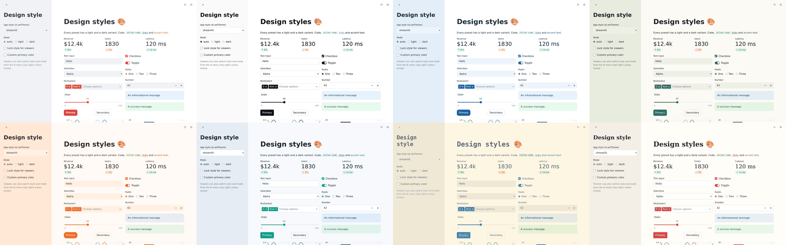
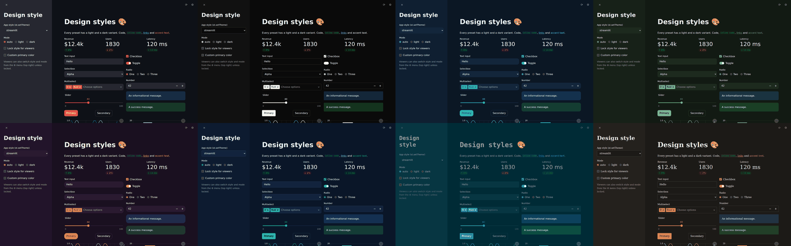

# Theming

Streamlit itself offers only Light/Dark ("Use system setting") plus custom colors in
`config.toml`. streamlitd keeps that model and adds **8 named design styles (presets)**. Each
preset has a light and a dark variant.




| Preset | Look |
|---|---|
| `streamlit` | the default Streamlit look |
| `minimal` | monochrome, outlined inputs |
| `ocean` | cool blues, rounder corners |
| `forest` | greens on warm off-white |
| `sunset` | orange/violet, rounded font |
| `finance` | navy and green, dashboard look |
| `solarized` | Solarized palettes, monospace headings |
| `paper` | editorial serif |

## Choosing a style

From code:

<!-- wrap -->
```d
st.setTheme("ocean");                       // mode stays "auto" (follows the OS)
st.setTheme("finance", "dark");             // "auto" | "light" | "dark"
st.setPageConfig(title: "Report", theme: "paper", allowThemeSwitch: false);
```

From configuration, as the default for all users:

```toml
# .streamlitd/config.toml
[theme]
preset = "finance"
mode = "dark"          # Streamlit's `base = "dark"` works too
```

From the command line:

```sh
./app --theme ocean --theme-mode dark
```

The list of presets is available at runtime as `themePresetNames()`.

## Custom colors and fonts

Override any token on top of a preset. The names follow Streamlit's `[theme]` keys:

<!-- wrap -->
```d
auto t = Theme("minimal", "light");
t.overrides.primaryColor = "#7c3aed";
t.overrides.font = fontSerif;          // also fontSans, fontMono, fontRounded or any CSS font-family
t.overrides.baseRadius = "1rem";
t.overrides.chartColors = ["#7c3aed", "#06b6d4", "#f59e0b"];
st.setTheme(t);
```

| Token | Meaning |
|---|---|
| `primaryColor` | buttons, sliders, active tabs, accents |
| `primaryTextColor` | text on primary-colored surfaces |
| `backgroundColor` | page background |
| `secondaryBackgroundColor` | sidebar, code blocks, inputs (unless overridden) |
| `textColor` | text; muted text and borders are derived from it |
| `linkColor` | links |
| `borderColor` | borders (default: derived from `textColor`) |
| `sidebarBackgroundColor` | sidebar |
| `widgetBackgroundColor` | input backgrounds |
| `widgetBorderColor` | input borders (set it for an "outlined" look) |
| `codeBackgroundColor` | code blocks |
| `font`, `headingFont`, `codeFont` | font stacks; Streamlit's `"sans serif"`, `"serif"` and `"monospace"` are accepted in config, environment and on the command line |
| `baseRadius` | corner radius (`"0.5rem"`) |
| `chartColors` | categorical palette for charts (Vega-Lite, Plotly, maps) |

In `config.toml`:

```toml
[theme]
preset = "streamlit"
primaryColor = "#0055aa"
font = "serif"
chartColors = ["#0055aa", "#ff8800", "#22aa55"]
```

or on the command line: `--theme.primaryColor=#0055aa`.

## The viewer style menu

The ⚙ button in the top-right corner lets **viewers** choose:

- the mode: System / Light / Dark;
- any design style.

The choice is stored in the browser's local storage. It is dropped as soon as the app
explicitly switches to a different theme, so an app-driven style change always wins. Hide the
menu with `setTheme(t, allowThemeSwitch: false)`, `setPageConfig(allowThemeSwitch: false)`,
`[theme] allowSwitch = false`, or `--no-theme-switch`.

## Charts and components follow the theme

Chart palettes, fonts and grid colors (Vega-Lite and Plotly), map markers and custom components
(through the `theme` field of the render message) all use the active style. Charts re-render
when the style or mode changes.

## Offline fonts

All presets use system font stacks. No web fonts are downloaded, so apps look right on
air-gapped networks. To use a specific font family, install it on the client machines (or load
it with `st.html("<style>@font-face{...}</style>")`) and set `font:`.
