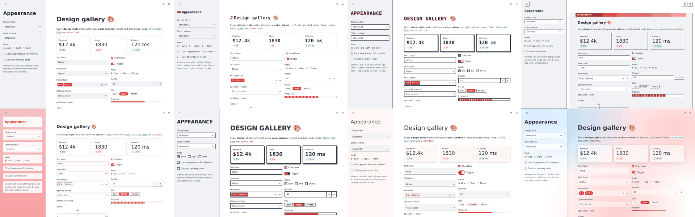
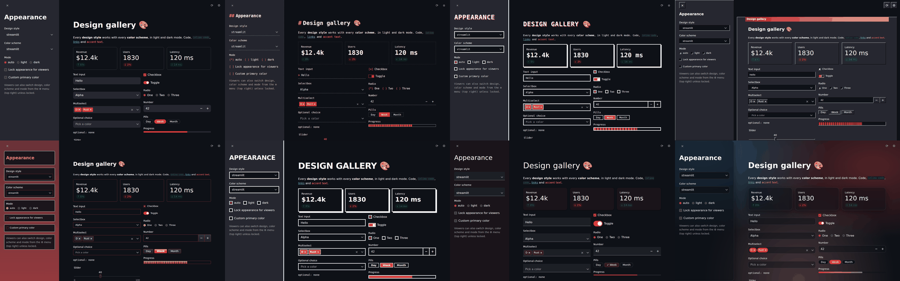
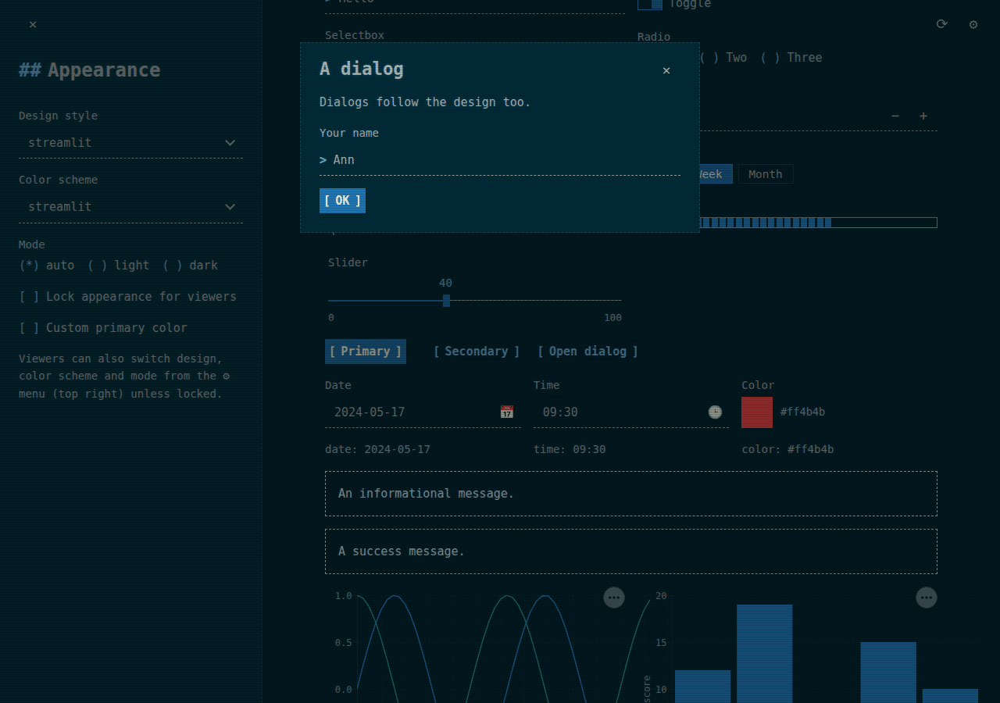
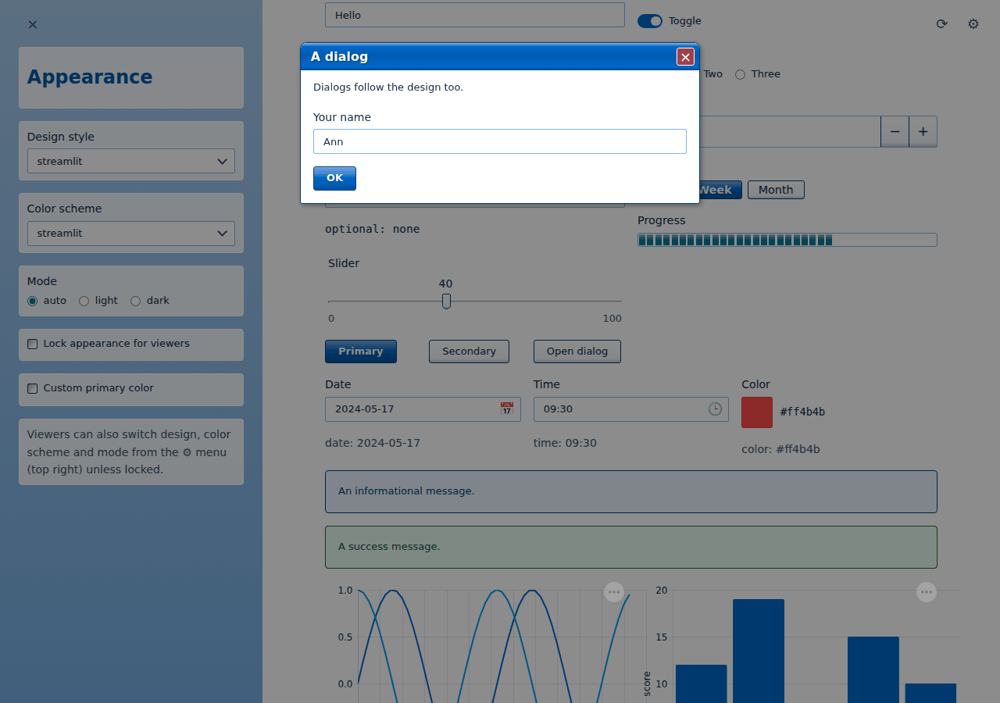
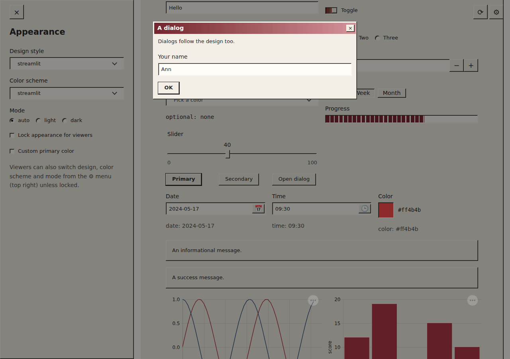
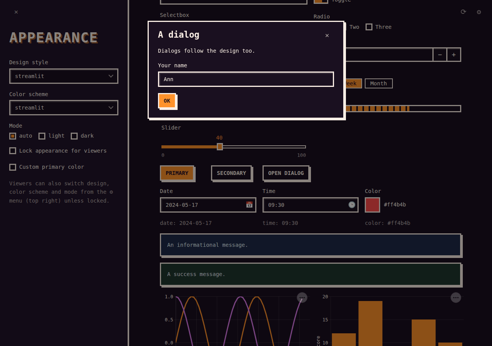
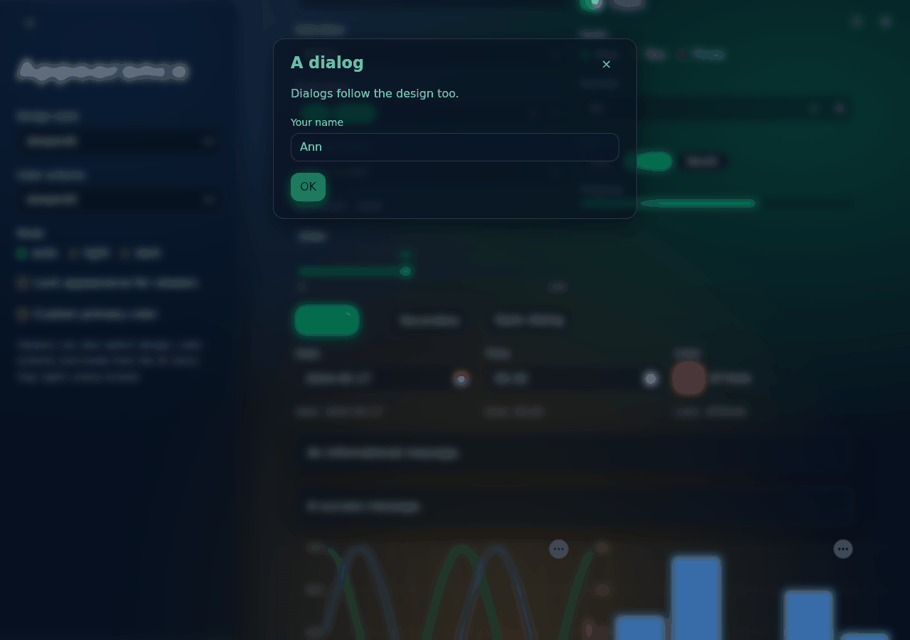
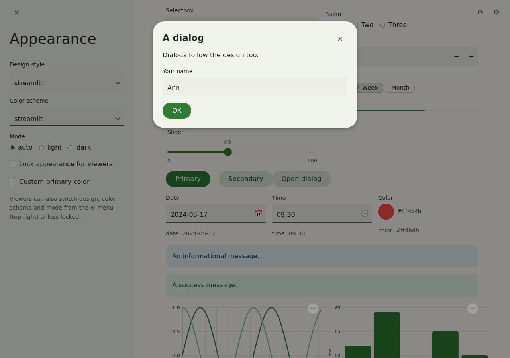
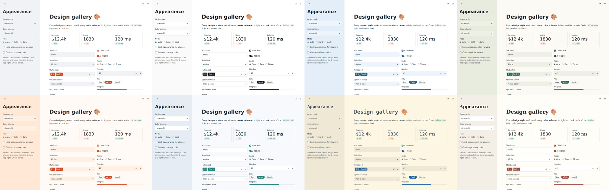
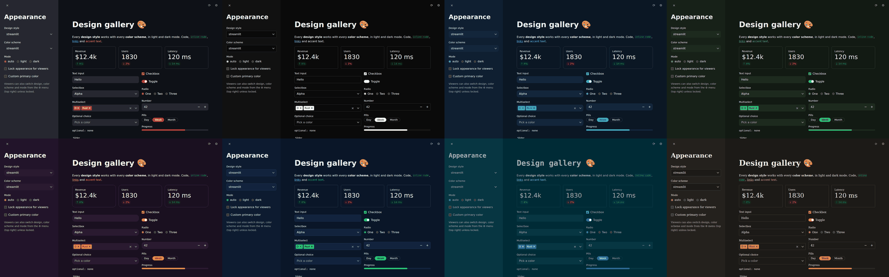

# Theming: design styles, color schemes and mode

A streamlitd page's look is made of three independent choices:

| Axis | What it changes | Choices |
|---|---|---|
| **Design style** | the *shape* of the UI: fonts, borders, corners, shadows, buttons, inputs, title bars, tabs, dialogs, chart strokes | 8 designs |
| **Color scheme** | the *palette*: background, text, primary color, chart colors | 8 schemes |
| **Mode** | light or dark variant of the scheme | `auto` (follows the OS), `light`, `dark` |

Every design works with every color scheme in both modes: 8 × 8 × 2 = 128 combinations.
Streamlit itself only offers Light/Dark plus custom colors in `config.toml`. streamlitd keeps
that model (the same `[theme]` keys work) and adds the two named axes.

Apps can add their own color schemes and design styles, in D code or in `config.toml`; they appear
in the appearance menu next to the built-in ones. See [Extending streamlitd](extending.md).

## Design styles




| Design | Look |
|---|---|
| `streamlit` | the default Streamlit look |
| `terminal` | monospace everywhere, `[ bracket ]` buttons, `#` headings, `[x]` checkboxes, dashed borders, `>` input prompts; phosphor glow and scanlines in dark mode |
| `retro` | 8-bit: chunky 3px borders, hard offset shadows that "press" on click, uppercase type, blocky progress bars |
| `win95` | classic 3D bevels, raised buttons and sunken inputs, gradient title bars on the page, expanders and dialogs, property-sheet tabs |
| `xp` | XP-inspired "Luna": glossy rounded title bars, gradient buttons with a highlighted hover, task-pane sidebar, block progress bar |
| `brutalist` | thick borders, hard shadows, bold uppercase headings, high contrast |
| `material` | Material 3–like: pill buttons, filled inputs with an underline indicator, elevated cards, large rounded dialogs |
| `glass` | glassmorphism: translucent blurred panels over a soft gradient backdrop, pill tabs |

Designs draw all their colors from the active color scheme. The XP title bars use the scheme's
primary color, the win95 chrome is derived from its secondary background, and so on. A few
designs bring their own fonts: `terminal` and `retro` (monospace), `win95` and `xp` (Tahoma),
and `material` (Roboto). They also adjust chart line widths, bar corners and grid style.

Some combinations:

| | |
|---|---|
|  `terminal` × `solarized`, dark |  `xp` × `ocean`, light |
|  `win95` × `paper`, light |  `retro` × `sunset`, dark |
|  `glass` × `finance`, dark |  `material` × `forest`, light |

## Color schemes




| Scheme | Palette |
|---|---|
| `streamlit` | the default Streamlit colors |
| `minimal` | monochrome, outlined inputs |
| `ocean` | cool blues |
| `forest` | greens on warm off-white |
| `sunset` | orange/violet, rounded font |
| `finance` | navy and green |
| `solarized` | Solarized palettes, monospace headings |
| `paper` | warm paper, serif type |

For a company palette, [register your own scheme](extending.md#color-schemes) instead of
overriding tokens one by one: it works in light and dark mode and appears in the viewer menu.

## Choosing design, scheme and mode

**From code.** Any part you leave out keeps its current value:

<!-- wrap -->
```d
st.setTheme(design: "terminal");                              // only the design
st.setTheme(scheme: "ocean", mode: "dark");                    // scheme + mode
st.setTheme("finance", "dark", "xp");                          // scheme, mode, design (positional)
st.setPageConfig(title: "Report", design: "win95", colorScheme: "paper", allowThemeSwitch: false);
```

`designNames()` and `colorSchemeNames()` list the valid names at runtime. Unknown names raise
an error that lists the valid ones.

**From configuration**, as the default for all users:

```toml
# .streamlitd/config.toml
[theme]
design = "material"
scheme = "forest"      # `preset` is accepted as an old name
mode = "dark"          # Streamlit's `base = "dark"` works too
```

**From the command line** or **environment**:

```sh
./app --design retro --color-scheme sunset --theme-mode dark      # --theme is an alias of --color-scheme
STREAMLITD_THEME_DESIGN=glass STREAMLITD_THEME_SCHEME=ocean ./app
```

## Custom colors and fonts

Override any token on top of the scheme and design. The names follow Streamlit's `[theme]` keys:

<!-- wrap -->
```d
auto t = Theme("minimal", "light", "material");   // scheme, mode, design
t.overrides.primaryColor = "#7c3aed";
t.overrides.font = fontSerif;          // also fontSans, fontMono, fontRounded or any CSS font-family
t.overrides.baseRadius = "1rem";
t.overrides.chartColors = ["#7c3aed", "#06b6d4", "#f59e0b"];
st.setTheme(t);
```

Precedence, lowest to highest:

1. the color scheme's tokens;
2. the tokens a design forces (fonts, corner radius);
3. your explicit `overrides`.

So `Theme("paper", "light", "terminal")` uses the terminal's monospace font, while an override of
`font` wins over both.

| Token | Meaning |
|---|---|
| `primaryColor` | buttons, sliders, active tabs, title bars, accents |
| `primaryTextColor` | text on primary-colored surfaces |
| `backgroundColor` | page background |
| `secondaryBackgroundColor` | sidebar, code blocks, inputs, win95 chrome |
| `textColor` | text; muted text and borders are derived from it |
| `linkColor` | links |
| `borderColor` | borders (default: derived from `textColor`) |
| `sidebarBackgroundColor` | sidebar |
| `widgetBackgroundColor` | input backgrounds |
| `widgetBorderColor` | input borders (set it for an "outlined" look) |
| `codeBackgroundColor` | code blocks |
| `font`, `headingFont`, `codeFont` | font stacks; Streamlit's `"sans serif"`, `"serif"` and `"monospace"` are accepted in config, environment and on the command line |
| `baseRadius` | corner radius (`"0.5rem"`) |
| `chartColors` | categorical palette for charts (Vega-Lite, Plotly, maps) |

In `config.toml`:

```toml
[theme]
scheme = "streamlit"
primaryColor = "#0055aa"
font = "serif"
chartColors = ["#0055aa", "#ff8800", "#22aa55"]
```

or on the command line: `--theme.primaryColor=#0055aa`.

## The viewer appearance menu

The ⚙ button in the top-right corner lets **viewers** choose (the app can move it into a ⋮ menu,
or out of the header to a button of its own: [Header controls](layout-and-navigation.md#header-controls-rerun-and-appearance)):

- the design style (a list and preview cards);
- the color scheme (a list and swatches);
- the mode: System, Light or Dark.

The choice is stored in the browser's local storage. It is dropped as soon as the app
explicitly switches to a different theme, so an app-driven change always wins. Hide the menu with
`setTheme(t, allowThemeSwitch: false)`, `setPageConfig(allowThemeSwitch: false)`,
`[theme] allowSwitch = false`, or `--no-theme-switch`.

## Charts and components follow the theme

Chart palettes, fonts, grid colors, line widths and bar corners (Vega-Lite and Plotly), map
markers, and custom components all use the active design and scheme. Components receive them
through the `theme` field of the render message: `design`, `colorScheme`, `base` and the colors.
Charts re-render when the design, scheme or mode changes.

## Pop-ups and controls follow the design

Drop-downs, multiselect lists, the calendar, the time list and the color picker are streamlitd's own
components (no native browser pop-ups), so they take the design's look as well: dashed in terminal, beveled
in win95, framed in xp, hard shadows in retro/brutalist, elevated in material and blurred in glass.

## Accessibility

Text colors are checked automatically: body text, muted text, primary-colored text and text on primary fills
are adjusted per color scheme (and per override) to reach WCAG AA contrast (4.5:1). The brand primary color is
kept for borders and decoration. The UI audit (see [Testing](testing.md#ui-audit)) verifies this for every
design × scheme × mode.


Decorative characters added by designs (terminal brackets and `#` prefixes, the win95 window
title) use CSS generated content with empty alternative text, so screen readers and accessible
names stay the same in every design. Check contrast when you combine custom colors with a design.

## Offline fonts

All designs and schemes use system font stacks. No web fonts are downloaded, so apps look right
on air-gapped networks. If a font such as Tahoma or Roboto isn't installed, the next font in the
stack is used. To use a specific font family, install it on the client machines (or load it with
`st.html("<style>@font-face{...}</style>")`) and set `font:`.

## Writing your own design

A design has two parts: its data (a `DesignStyle`: name, label, description, forced fonts and
radius, and chart tweaks) and a block of CSS rules, all scoped by `:root[data-design="<name>"]`.

- **In an app**, register it with `registerDesign` or `[theme.designs.<name>]`: see
  [Extending streamlitd](extending.md#design-styles).
- **In streamlitd itself** (contributors), add the `DesignStyle` to `builtinDesigns()` in
  `source/streamlitd/theme.d` and the rules to `assets/designs.css`.

Either way, the same conventions apply:

Surfaces, text and borders must use only the scheme tokens (`--primary`, `--bg`, `--bg2`,
`--text`, `--border`, `--widget-bg`, `--chart-N`, …) and `color-mix()`, so the design works with
every scheme and mode. The only fixed colors allowed are:

- structural black and white (bevel shading, title-bar text);
- small signature accents that are always blended with a scheme token, e.g.
  `color-mix(in srgb, var(--primary) 35%, #ffb733)` for the xp hover glow.

Add preview card rules (`.dc-preview[data-design="<name>"]`). For a built-in design, then run
`python3 tools/gen_assets.py` and add a probe for it to `tests/e2e/specs/themes.spec.js`.

For a one-off tweak in a single app, inject CSS scoped the same way:

<!-- wrap -->
```d
st.html(`<style>:root[data-design="terminal"] .heading h1 { letter-spacing: .2em; }</style>`);
```
