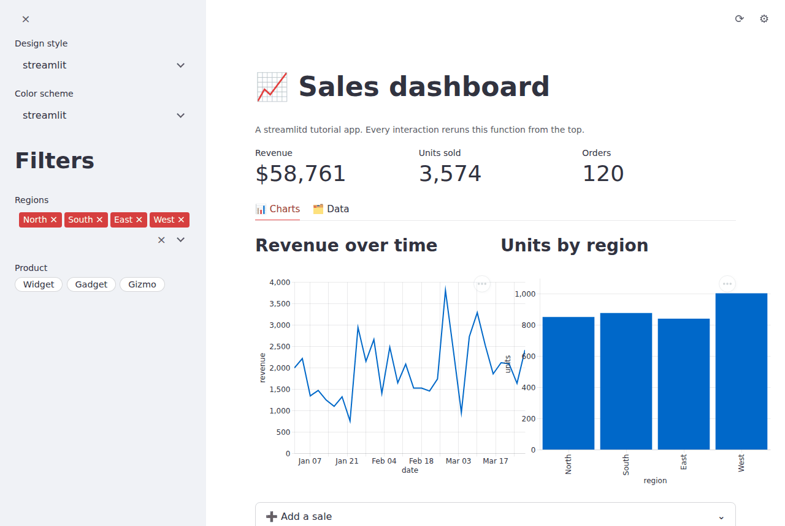
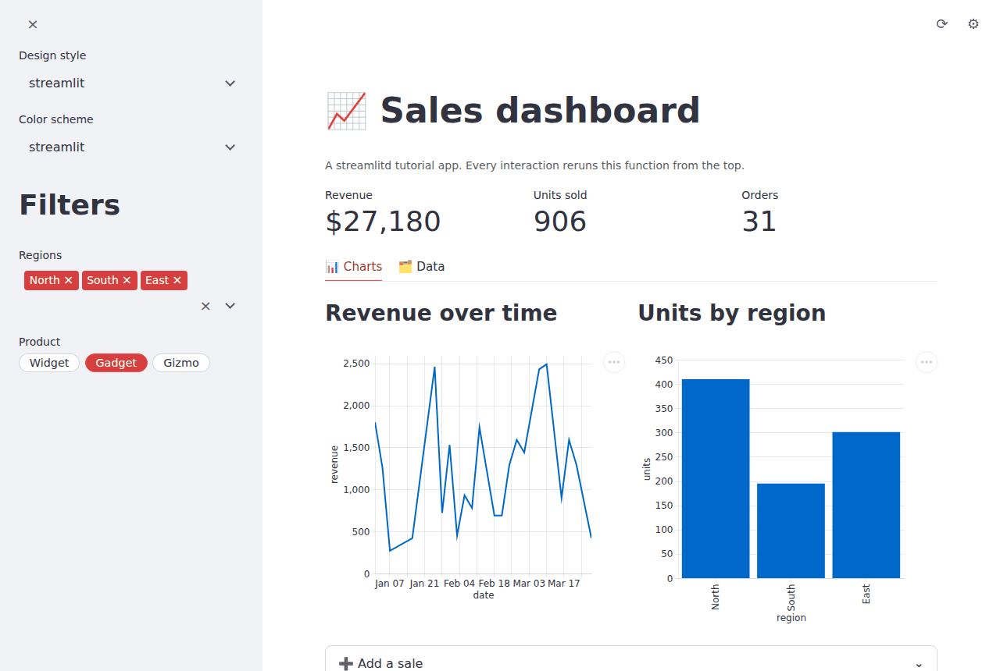
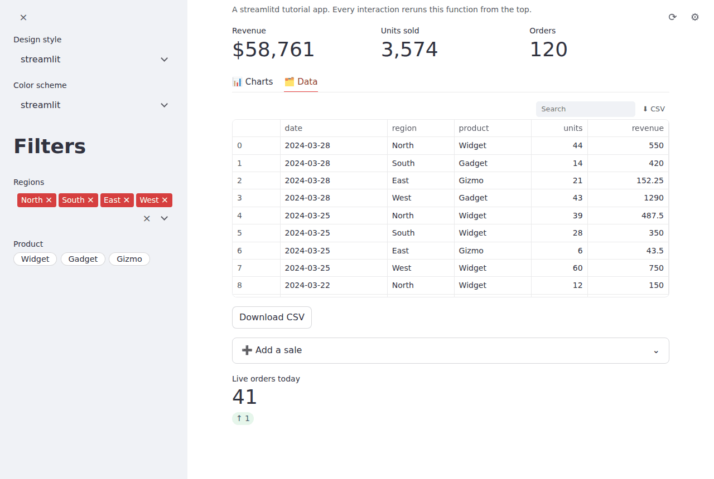
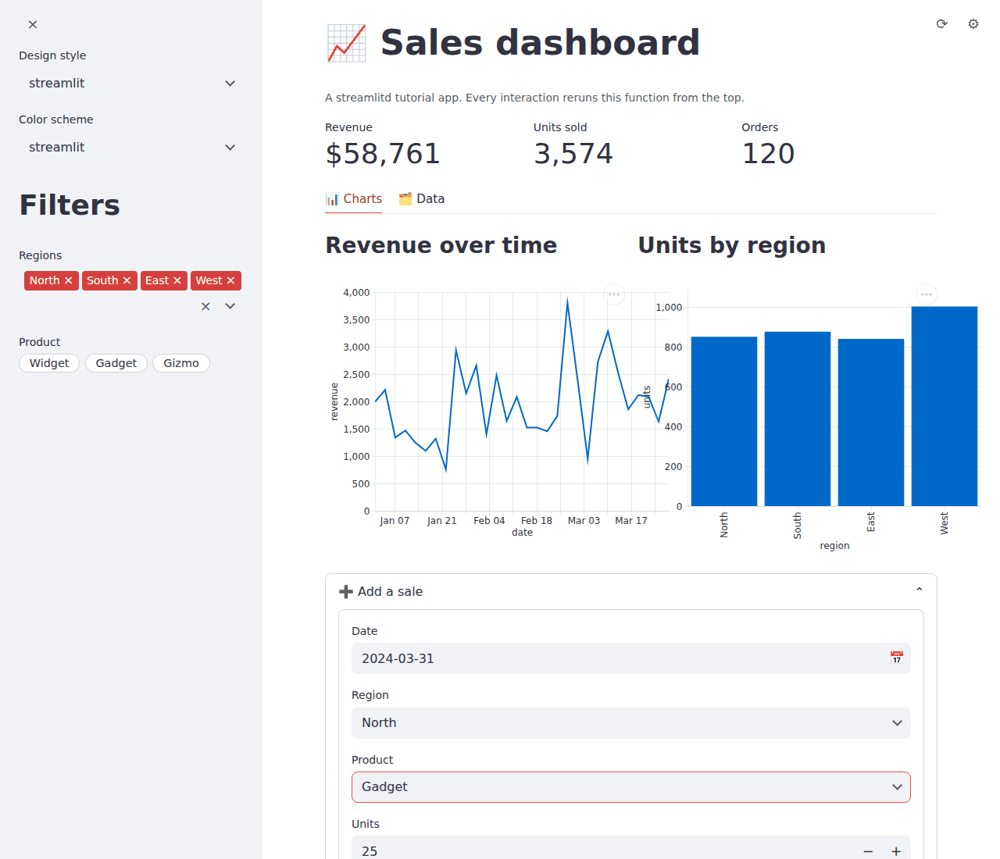
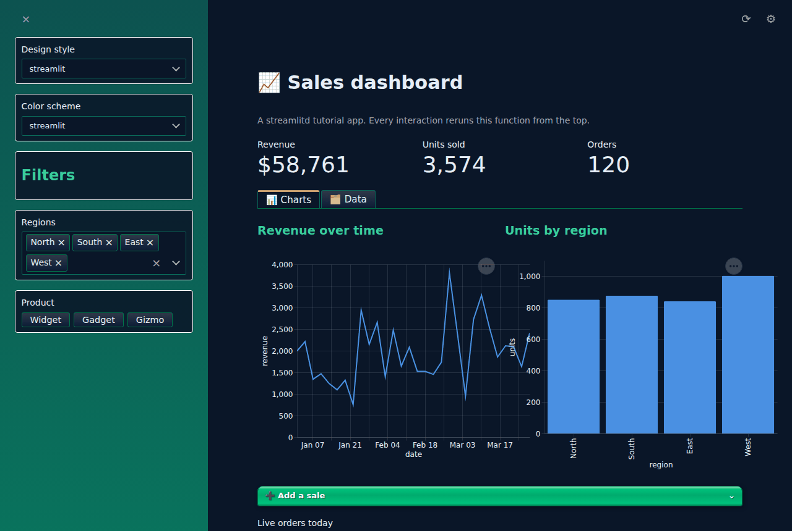

# Tutorial: a sales dashboard

In this tutorial you build a small but complete dashboard: a CSV loaded once and cached,
sidebar filters, metrics, charts, a data table with download, a form that adds data, a live
auto-refreshing number, and a design-style switcher.



The finished code is [`examples/tutorial/app.d`](../examples/tutorial/app.d). To run it:

```sh
cd examples/tutorial && dub run --compiler=ldc2
```

You'll learn:

| Step | Concept |
|---|---|
| 1 | the rerun model, text elements |
| 2 | loading data into a `DataFrame`, `cacheData` |
| 3 | sidebar widgets as filters |
| 4 | `columns` and `metric` |
| 5 | `tabs`, charts, `dataframe`, `downloadButton` |
| 6 | `form`, `st.session`, `st.rerun` |
| 7 | `st.fragment` with `runEvery` |
| 8 | page config, design styles and color schemes |

## Setup

Create a project as in [Getting started](getting-started.md) and put a CSV at `data/sales.csv`:

```csv
date,region,product,units,revenue
2024-01-01,North,Gadget,46,1380.00
2024-01-01,South,Widget,11,137.50
2024-01-01,East,Gizmo,40,290.00
...
```

The CSV used here (120 rows) is [`examples/tutorial/data/sales.csv`](../examples/tutorial/data/sales.csv).

## Step 1: a first page

<!-- no-compile -->
```d
import streamlitd;

void app(St st)
{
    st.title("📈 Sales dashboard");
    st.caption("A streamlitd tutorial app. Every interaction reruns this function from the top.");
}

mixin StreamlitMain!app;
```

`app` is called **once per interaction, per browser tab**. Each call describes the whole page
again; the browser compares it with what is on screen and updates only what changed. You never write event handlers
or update the DOM yourself.

## Step 2: load and cache the data

<!-- no-compile -->
```d
DataFrame loadSales(string path)
{
    return DataFrame.readCsv(path);       // column types are inferred: date, text, integer, number
}

void app(St st)
{
    // ...
    auto sales = cacheData!loadSales("data/sales.csv");
}
```

Because `app` reruns on every click, reading the file each time would be wasteful.
`cacheData!fn(args)` runs `fn` once per distinct argument list and shares the result between
all sessions. Like Streamlit's `@st.cache_data`, every caller gets a **copy**, so modifying the
returned frame (as step 6 does) is safe. Use `cacheData!(fn, 600)` for a 10-minute TTL, and
`cacheResource!fn` for shared objects such as database pools.

## Step 3: filters in the sidebar

<!-- no-compile -->
```d
    st.sidebar.header("Filters");
    auto regions = st.sidebar.multiselect("Regions", ["North", "South", "East", "West"],
        ["North", "South", "East", "West"]);
    auto product = st.sidebar.pills("Product", ["Widget", "Gadget", "Gizmo"]);   // null = none selected

    auto view = sales.filter((Row r) =>
        regions.canFind(r.get!string("region")) &&
        (product is null || r.get!string("product") == product));
```

Widgets **return their current value**. When the user changes a filter, `app` reruns and
`view` is recomputed with the new values. Everything below it updates automatically.



## Step 4: key metrics in columns

<!-- no-compile -->
```d
    auto m = st.columns(3);
    m[0].metric("Revenue", format("$%,.0f", view.sum("revenue")));
    m[1].metric("Units sold", format("%,.0f", view.sum("units")));
    m[2].metric("Orders", cast(long) view.length);
```

`st.columns(n)` returns an array of containers. Anything you call on `m[1]` is drawn inside
that column. Use `st.columns([2.0, 1, 1])` for relative widths.

## Step 5: charts and data in tabs

<!-- no-compile -->
```d
    auto tabs = st.tabs(["📊 Charts", "🗂 Data"]);
    with (tabs[0])
    {
        auto c = columns(2);
        c[0].subheader("Revenue over time");
        c[0].lineChart(view.groupBy("date", ["revenue"], "sum"), x: "date", height: 280);
        c[1].subheader("Units by region");
        c[1].barChart(view.groupBy("region", ["units"], "sum"), x: "region", height: 280);
    }
    with (tabs[1])
    {
        dataframe(view.sortBy("date", false), height: 320);
        downloadButton("Download CSV", view.toCsv(), "sales.csv", "text/csv");
    }
```

`with (container) { ... }` is D's counterpart of Python's `with st.sidebar:`. Inside the block,
`dataframe(...)` means `tabs[1].dataframe(...)`. The table is sortable and searchable, and
has its own CSV export.



## Step 6: a form that adds data

<!-- no-compile -->
```d
    // before the filters: append rows the user added earlier in this session
    foreach (row; st.session.get!(Json[][])("added"))
        sales.appendRow(row);

    // ...

    with (st.expander("➕ Add a sale"))
    {
        auto f = form("add_sale", clearOnSubmit: true);
        auto day = f.dateInput("Date", Date(2024, 3, 31));
        auto region = f.selectbox("Region", ["North", "South", "East", "West"]);
        auto prod = f.selectbox("Product", ["Widget", "Gadget", "Gizmo"]);
        auto units = f.numberInput("Units", 10, minValue: 1);          // int overload
        auto price = f.numberInput("Price", 12.5, minValue: 0, step: 0.5); // double overload
        if (f.formSubmitButton("Add", type: "primary"))
        {
            auto added = st.session.get!(Json[][])("added");
            added ~= [Json(day.toISOExtString), Json(region), Json(prod), Json(cast(long) units), Json(units * price)];
            st.session["added"] = added;
            st.toast(format("Added %d × %s", units, prod), icon: "✅");
            st.rerun();
        }
    }
```

Three ideas meet here:

- **Forms** batch their widgets. Editing a field inside a form does not rerun the app; only the
  submit button does. `clearOnSubmit` resets the fields after a submit.
- **`st.session`** (Streamlit's `st.session_state`) keeps values for this browser tab across
  reruns. Local variables do not survive a rerun.
- **`st.rerun()`** starts a new run immediately, so the metrics and charts above the form
  include the new row.



## Step 7: a live, auto-refreshing number

<!-- no-compile -->
```d
    st.fragment((St f) {
        auto ticks = st.session.get!int("ticks") + 1;
        st.session["ticks"] = ticks;
        f.metric("Live orders today", 40 + ticks, "+1");
    }, runEvery: 2);
```

A **fragment** is a part of the page that can rerun on its own. `runEvery: 2` reruns just this
block every 2 seconds without touching the rest of the page. Widgets inside a fragment also
rerun only the fragment. That is useful for expensive pages where a small control must stay
fast.

## Step 8: page config, design style and color scheme

<!-- no-compile -->
```d
    st.setPageConfig(title: "Sales dashboard", icon: "📈", layout: Layout.wide);
    auto design = st.sidebar.selectbox("Design style", designNames(), key: "design");
    auto scheme = st.sidebar.selectbox("Color scheme", colorSchemeNames(), key: "scheme");
    st.setTheme(scheme: scheme, design: design);
```

`setPageConfig` sets the browser tab title, the favicon and the wide layout. `setTheme`
picks one of the [8 design styles](theming.md) (the UI's shape: terminal, retro, win95, XP,
brutalist, material, glass, or the default) and one of the 8 color schemes, independently.
Viewers can also choose design, scheme and light/dark mode from the ⚙ menu in the top-right corner.



## The complete program

<!-- compile -->
```d
/// Tutorial app: a small sales dashboard. docs/tutorial.md builds it step by step.
import streamlitd;
import std.algorithm : canFind, map;
import std.array : array;
import std.conv : to;
import std.format : format;

// --- Step 2: load the data once; cached across reruns and sessions --------------------
DataFrame loadSales(string path)
{
	return DataFrame.readCsv(path);
}

void app(St st)
{
	// --- Step 8: page config, design style and color scheme--------------------------------------
	st.setPageConfig(title: "Sales dashboard", icon: "📈", layout: Layout.wide);
	auto design = st.sidebar.selectbox("Design style", designNames(), key: "design");
	auto scheme = st.sidebar.selectbox("Color scheme", colorSchemeNames(), key: "scheme");
	st.setTheme(scheme: scheme, design: design);

	// --- Step 1: text ------------------------------------------------------------------
	st.title("📈 Sales dashboard");
	st.caption("A streamlitd tutorial app. Every interaction reruns this function from the top.");

	// --- Step 2 + 6: cached CSV plus rows added through the form (kept in session state) --
	auto sales = cacheData!loadSales("data/sales.csv"); // a copy: safe to modify
	foreach (row; st.session.get!(Json[][])("added"))
		sales.appendRow(row);

	// --- Step 3: sidebar filters --------------------------------------------------------
	st.sidebar.header("Filters");
	auto regions = st.sidebar.multiselect("Regions", ["North", "South", "East", "West"],
		["North", "South", "East", "West"]);
	auto product = st.sidebar.pills("Product", ["Widget", "Gadget", "Gizmo"]);
	auto view = sales.filter((Row r) =>
		regions.canFind(r.get!string("region")) &&
		(product is null || r.get!string("product") == product));

	// --- Step 4: key metrics in columns ------------------------------------------------
	auto m = st.columns(3);
	m[0].metric("Revenue", format("$%,.0f", view.sum("revenue")));
	m[1].metric("Units sold", format("%,.0f", view.sum("units")));
	m[2].metric("Orders", cast(long) view.length);

	// --- Step 5: table and charts in tabs ----------------------------------------------
	auto tabs = st.tabs(["📊 Charts", "🗂 Data"]);
	with (tabs[0])
	{
		auto c = columns(2);
		c[0].subheader("Revenue over time");
		c[0].lineChart(view.groupBy("date", ["revenue"], "sum"), x: "date", height: 280);
		c[1].subheader("Units by region");
		c[1].barChart(view.groupBy("region", ["units"], "sum"), x: "region", height: 280);
	}
	with (tabs[1])
	{
		dataframe(view.sortBy("date", false), height: 320);
		downloadButton("Download CSV", view.toCsv(), "sales.csv", "text/csv");
	}

	// --- Step 6: a form that adds a row --------------------------------------------------
	with (st.expander("➕ Add a sale"))
	{
		auto f = form("add_sale", clearOnSubmit: true);
		auto day = f.dateInput("Date", Date(2024, 3, 31));
		auto region = f.selectbox("Region", ["North", "South", "East", "West"]);
		auto prod = f.selectbox("Product", ["Widget", "Gadget", "Gizmo"]);
		auto units = f.numberInput("Units", 10, minValue: 1);
		auto price = f.numberInput("Price", 12.5, minValue: 0, step: 0.5);
		if (f.formSubmitButton("Add", type: "primary"))
		{
			auto added = st.session.get!(Json[][])("added");
			added ~= [Json(day.toISOExtString), Json(region), Json(prod), Json(cast(long) units), Json(units * price)];
			st.session["added"] = added;
			st.toast(format("Added %d × %s", units, prod), icon: "✅");
			st.rerun();
		}
	}

	// --- Step 7: a live fragment that refreshes itself every 2 seconds -------------------
	st.fragment((St f) {
		auto ticks = st.session.get!int("ticks") + 1;
		st.session["ticks"] = ticks;
		f.metric("Live orders today", 40 + ticks, "+1");
	}, runEvery: 2);
}

mixin StreamlitMain!app;
```

## Where to go next

- [Core concepts](concepts.md) explains reruns, widget keys, callbacks and fragments in depth.
- [Data & charts](data-and-charts.md) covers everything `DataFrame` and the chart elements can do.
- [Deployment](deployment.md) shows how to put the dashboard on a server.
- [Testing](testing.md) shows how to write a headless test for this app with `AppTest`.
